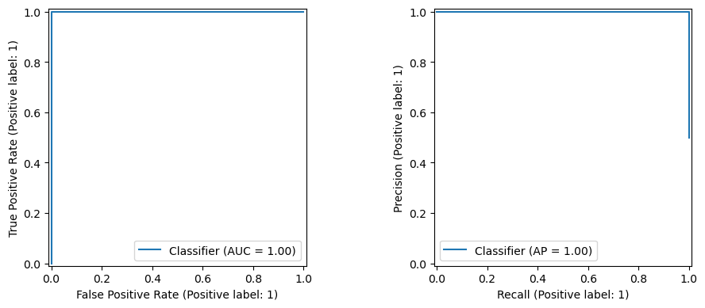
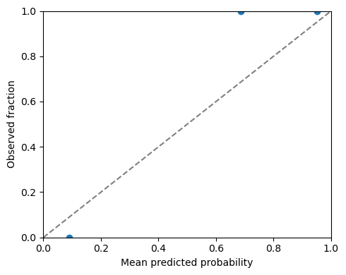

# 基于 Bernoulli 朴素贝叶斯的膀胱炎症预测实验

## 摘要

本实验以 UCI Acute Inflammations 数据集为例，研究如何根据六项二元症状建立膀胱炎症分类模型，并从分类结果、概率误差和数据划分三个方面评价模型。将120条专家构造记录划分为72条训练记录、24条验证记录和24条测试记录，采用 Laplace 平滑的 Bernoulli 朴素贝叶斯估计阳性概率，通过验证集选择分类阈值，在固定方案后评价测试集。结果表明，模型在验证集和测试集上的准确率均为1，平均对数损失分别为0.087214和0.074492；验证集 ROC-AUC 与平均精确率 AP 均为1。手算后验概率与程序结果一致。复制腰痛特征的对照实验中，增加5个副本使验证准确率降至0.75，说明重复相关信息会影响朴素贝叶斯的推断。由于数据规模小、记录由专家构造，且验证与测试的症状组合均已在训练集中出现，本结果仅说明当前数据划分下的表现，尚不能说明真实临床应用效果。

**关键词：** 朴素贝叶斯；条件独立；Laplace平滑；对数损失；分类阈值

## 1 引言

根据症状判断疾病，可以看作一个从输入到输出的学习问题。症状是模型可以观察的输入，疾病状态是希望预测的标签。难点在于，某项症状并不只出现在一种疾病状态中，同样的症状组合也未必对应完全确定的结果。因此，模型先给出阳性概率，再按照阈值得到类别，比直接给出“有病”或“无病”包含更多信息。

本实验使用六项症状预测膀胱炎症，重点考察三个问题：模型如何从计数中学到参数，如何通过贝叶斯公式把症状信息转成疾病概率，以及怎样判断预测是否可靠。为此，先建立朴素贝叶斯模型并手算一次预测，再比较基线、分类指标和概率损失，最后通过特征重复实验讨论条件独立假设的影响。

## 2 数据与方法

### 2.1 研究数据与输入输出

数据来自 UCI Acute Inflammations，共120条由专家构造、用于专家系统测试的记录[1]。每一行是一条样本，不能直接等同于一名独立就诊患者。本实验以 `bladder_inflammation` 为标签，1表示膀胱炎症阳性，0表示阴性。将体温按是否达到38°C转成发热指标，与其余五项症状共同作为输入，见表1。

表1 模型使用的六项二元特征

| 顺序 | 特征名称 | 变量名 | 取值含义 |
|---|---|---|---|
| 1 | 发热 | fever_ge_38 | 体温≥38°C为1，否则为0 |
| 2 | 恶心 | nausea | 出现为1，未出现为0 |
| 3 | 腰痛 | lumbar_pain | 出现为1，未出现为0 |
| 4 | 尿急 | urine_pushing | 出现为1，未出现为0 |
| 5 | 排尿痛 | micturition_pain | 出现为1，未出现为0 |
| 6 | 尿道灼痛 | burning_urethra | 出现为1，未出现为0 |

本实验的数据模型由输入、需要估计的参数和预测规则共同组成。只罗列六项症状，还没有说明它们怎样与标签联系；训练得到的类别比例、类内症状概率以及贝叶斯计算规则，才构成从输入到预测的完整关系。ID、连续体温原值和两个疾病标签均不进入六输入模型。特别是，将待预测的标签放进输入，会使模型提前获得答案，形成数据泄漏。

模型处理流程为：六项症状 x → 由训练参数计算阳性概率 p → 与阈值 t 比较 → 输出预测类别。概率 p=0.8表示模型估计该输入的阳性可能性为80%；类别1则只是阈值判断后的阳性结论，两者表达的信息不同。

### 2.2 训练、验证与测试的分工

训练是利用已知输入和标签估计参数；预测是把新输入代入固定参数计算结果。以工作单中独立的8条教学记录为例，有排尿痛的5条记录中4条阳性，经验频率模型便输出4/5=0.8；无排尿痛的3条中1条阳性，输出1/3。若加入一条有排尿痛的阴性记录并重新训练，前者变成4/6。若仅把一条新输入交给原模型预测，参数仍是原来的频率，不会自动更新。这组教学记录仅用于说明概念，不与本实验数据合并。

模型对未参与训练记录的预测能力称为泛化能力。训练成绩好并不能直接证明泛化良好；模型也可能过度贴合训练数据中的偶然规律，这就是过拟合。因此，本实验将参数估计、方案选择和最终评价分开，具体划分见表2。

表2 数据划分及用途

| 数据部分 | 总数 | 阴性/阳性 | 本实验用途 |
|---|---|---|---|
| 训练集 | 72 | 37/35 | 估计先验和类内症状概率 |
| 验证集 | 24 | 12/12 | 比较阈值及分析模型表现 |
| 测试集 | 24 | 12/12 | 固定方案后进行最终评价 |

三部分记录的ID互不相交。模型只用训练集的72条记录拟合，未合并验证集重新训练。主模型固定为 `BernoulliNB(alpha=1, binarize=None)`。阈值在验证集上选择：在0.05、0.1、0.2、0.3、0.5、0.7、0.8、0.9、0.95中，先要求敏感度不低于0.90，再选择特异度最高者；并列时取最接近0.5的阈值，仍并列则取较小者。固定输入、平滑参数和阈值后，按已获教师许可的流程使用测试标签。测试结果不再用于反过来挑选阈值或特征，否则测试集也会参与选择，失去独立评价的作用。

### 2.3 Bernoulli朴素贝叶斯与参数估计

贝叶斯公式把“已知疾病状态时，某组症状出现的可能性”转成“观察到这组症状后，疾病状态的可能性”。对于类别 c 和输入 x，有：

P(Y=c｜X=x) = P(X=x｜Y=c) × P(Y=c) / P(X=x)　　（1）

其中，P(Y=c)是先验，表示观察当前症状前的类别概率；P(X=x｜Y=c)是似然，表示假定类别为c时观察到当前症状的可能性；P(Y=c｜X=x)是后验，表示看到症状后对类别的判断。似然与后验的条件方向不同：前者在某类记录内部考察症状，后者在具有当前症状的情况下判断类别。分母是该症状组合出现的总概率，二分类时为两个类别下“似然×先验”的和，作用是将两个类别的权重归一化。

Bernoulli分布用于描述只有0和1两种结果的变量。若第j项症状在类别c中出现的概率为 θcj，则出现概率为 θcj，未出现概率为1−θcj。对观察值为1的特征，推断时采用 θcj；对观察值为0的特征，采用1−θcj。例如，已知某类中腰痛概率为0.7，输入有腰痛时乘0.7，输入无腰痛时乘0.3。因此，无症状也会影响预测，不能把值为0的特征直接忽略。

六个二元输入有2^6=64种组合，直接估计每类中所有组合的概率容易遇到计数不足。朴素贝叶斯假定在给定类别后，各特征条件独立，用单项概率乘积近似联合概率：

P(X=x｜Y=c) ≈ ∏j [θcj^xj × (1−θcj)^(1−xj)]，j=1,…,6　　（2）

这里假设的是同一类别内部的条件独立，并非所有记录中的症状彼此无关。例如，发热和腰痛可以在总体中相关；模型仍在给定疾病类别后，把它们分别作为证据相乘。这个简化降低了估计所需的数据量，也可能重复计算相关症状所包含的信息。

设训练总数为n，类别c有nc条，第j项症状为1的有kcj条。本实验采用以下估计：

πc = nc / n；θcj = (kcj+1) / (nc+2)　　（3）

式（3）对症状采用α=1的Laplace平滑，相当于给“出现”和“未出现”各补一次虚拟计数，所以分母增加2，而先验按原始类别比例估计。若某类中35条记录都有尿急，未经平滑会得到尿急概率35/35=1、无尿急概率0；新输入一旦没有尿急，该类别的整个似然乘积就会成为0。平滑后两者变为36/37和1/37，为训练中未出现的情况保留了非零概率。平滑表达的是有限样本下的不确定性，并不能保证模型的独立假设正确。

### 2.4 评价指标

本实验同时评价类别判断和概率输出。单条记录的二元对数损失为：

ℓ(y,p) = −[y ln(p) + (1−y) ln(1−p)]；L = (1/N)∑i ℓ(yi,pi)　　（4）

当真实标签为1时，损失是−ln(p)；真实标签为0时，是−ln(1−p)。正确类别得到的概率越高，损失越小；自信地预测错误会受到较大惩罚。例如，一条阴性记录被预测为阳性的概率从0.6升至0.99时，损失由0.916291升至4.605170。报告中的log loss均为各记录损失的平均值，采用自然对数。朴素贝叶斯通过训练计数估计参数，本实验并未用梯度下降最小化验证集log loss。

在给定阈值下，真实阳性且预测阳性为TP，真实阴性且预测阴性为TN，误报为FP，漏报为FN。准确率为(TP+TN)/N，敏感度为TP/(TP+FN)，特异度为TN/(TN+FP)，精确率为TP/(TP+FP)，F1为2TP/(2TP+FP+FN)。敏感度关注实际阳性中检出多少，精确率关注预测阳性中有多少是真的，二者分母不同。

此外，ROC曲线和PR曲线用于观察不同阈值下的区分能力，可靠性图用于比较预测概率与实际阳性比例。ROC-AUC、AP和概率校准分别反映不同方面，不能互相替代。

## 3 实验结果

### 3.1 单条记录的后验概率计算

对输入 x=(0,0,0,1,1,1)，即无发热、无恶心、无腰痛，同时有尿急、排尿痛和尿道灼痛，训练集中两类先验为π0=37/72，π1=35/72。各症状的计数及平滑后的似然项见表3。

表3 固定输入的类内计数与似然项

| 特征（输入值） | 类0出现计数 | 类1出现计数 | 类0采用的似然项 | 类1采用的似然项 |
|---|---|---|---|---|
| 发热（0） | 25 | 13 | 13/39=0.333333 | 23/37=0.621622 |
| 恶心（0） | 5 | 13 | 33/39=0.846154 | 23/37=0.621622 |
| 腰痛（0） | 30 | 13 | 8/39=0.205128 | 23/37=0.621622 |
| 尿急（1） | 13 | 35 | 14/39=0.358974 | 36/37=0.972973 |
| 排尿痛（1） | 5 | 28 | 6/39=0.153846 | 29/37=0.783784 |
| 尿道灼痛（1） | 13 | 17 | 14/39=0.358974 | 18/37=0.486486 |

表中计数是“症状为1”的数量，但前三项实际输入为0，因此使用补概率。例如，类0共有37条，其中25条发热；平滑后的不发热概率为(37−25+1)/(37+2)=13/39。

将各类的先验与六项似然相乘，可得：

w0 = (37/72)×(13/39)×(33/39)×(8/39)×(14/39)×(6/39)×(14/39) = 0.000589435361

w1 = (35/72)×(23/37)×(23/37)×(23/37)×(36/37)×(29/37)×(18/37) = 0.043319328441

p = w1/(w0+w1) = 0.986575906260　　（5）

w0和w1尚未归一化，不能直接作为类别概率。归一化后，阳性后验约为98.66%，在0.5阈值下预测为阳性。程序输出为0.9865759062601746，与未提前舍入的手算值之差约2.22e-16，属于浮点运算误差。

### 3.2 分类表现与概率损失

为判断症状是否提供了额外信息，设置只使用训练集阳性比例的基线模型。该模型对所有输入都输出35/72≈0.486111，在0.5阈值下全部预测为阴性。与主模型的比较见表4。

表4 固定阈值0.5下的分类结果与平均对数损失

| 模型与数据 | TN/FP/FN/TP | 准确率 | 平均log loss |
|---|---|---|---|
| 仅先验基线，验证集 | 12/0/12/0 | 0.500 | 0.693533 |
| 朴素贝叶斯，训练集 | 37/0/0/35 | 1.000 | 0.098840 |
| 朴素贝叶斯，验证集 | 12/0/0/12 | 1.000 | 0.087214 |
| 朴素贝叶斯，测试集 | 12/0/0/12 | 1.000 | 0.074492 |

主模型在验证和测试集上均无误报、无漏报，敏感度、特异度、精确率及F1均为1。基线验证敏感度为0、特异度为1、F1为0；因没有预测阳性，其精确率分母为0，应记为未定义。

尽管主模型各部分准确率都为1，平均对数损失仍不同，说明“类别全对”不等于“概率完全相同”。例如，真实标签为[1,0]时，预测概率[0.6,0.4]和[0.9,0.1]在0.5阈值下都全对，但平均损失分别为0.510826和0.105361。后者给正确类别分配了更高概率，因此损失更小。这里的两条记录仅用于解释指标，不是新增实验数据。

### 3.3 阈值选择与排序能力

验证集部分阈值结果见表5。判断规则统一采用p≥t时预测阳性。

表5 验证集上不同阈值的结果

| 阈值t | FP/FN | 敏感度 | 特异度 |
|---|---|---|---|
| 0.1 | 5/0 | 1.000000 | 0.583333 |
| 0.5 | 0/0 | 1.000000 | 1.000000 |
| 0.9 | 0/2 | 0.833333 | 1.000000 |

阈值从0.1提高到0.5后，5条误报被排除，仍未出现漏报；进一步提高到0.9，则有2条阳性被漏掉。可见，阈值改变的是概率转为类别的标准，不会重新训练模型，也不会改变已经计算的概率。在本次完整候选网格中，0.2、0.3、0.5、0.7和0.8均满足敏感度要求并达到特异度1，按既定并列规则最终选择0.5。

图1中，ROC横轴为假阳性率1−特异度，纵轴为敏感度；PR曲线展示召回率与精确率的关系。验证集ROC-AUC=1、AP=1，说明这24条记录的阳性与阴性可以按模型分数完全区分。图中的AP是平均精确率，并非用梯形法计算的PR曲线面积。较好的排序成绩也不能直接证明概率数值准确。

### 3.4 概率校准与条件独立假设的影响

可靠性图的横轴是同一概率区间内的平均预测概率，纵轴是这些记录的实际阳性比例。若模型对一批可比记录都预测约0.8，理想情况下其中约80%为阳性，点应接近对角线。图2第一个区间[0,0.2]有12条记录，平均预测概率为0.089002，实际阳性比例为0；(0.6,0.8]有1条，平均概率为0.685429，实际阳性比例为1；(0.8,1]有11条，平均概率为0.950279，实际阳性比例为1。中间两个区间没有记录，图上的连线不表示这些区间存在观察值。原图首区间左端写为−0.001，是绘图分箱为包含0所作的设置。

这些结果说明，本次分类和排序虽然没有错误，预测概率仍与各区间观测比例存在差异。但验证集仅24条，尤其单条记录的区间不稳定，不能据此断言模型在总体中存在同样方向、同样程度的校准偏差。

为观察重复证据的影响，在原六项输入之外增加腰痛特征的完全相同副本，分别重新拟合并在同一验证集比较，见表6。该对照用于分析假设，未据此更换主模型。

表6 重复腰痛特征的验证集结果

| 额外腰痛副本数 | 准确率 | 平均log loss | TN/FP/FN/TP |
|---|---|---|---|
| 0 | 1.000 | 0.087214 | 12/0/0/12 |
| 1 | 1.000 | 0.070425 | 12/0/0/12 |
| 5 | 0.750 | 0.385377 | 11/1/5/7 |

增加1个副本时准确率不变，损失反而略降；增加5个副本后，准确率和损失均变差。因此，不能把结果概括成“只要特征相关，表现就一定下降”。更准确的解释是，完全重复的特征不提供新信息，但朴素贝叶斯仍将每一列作为独立证据相乘，改变了各类的相对权重。

例如，记录A094真实为阳性且有腰痛，其原模型阳性概率为0.874262，增加5个腰痛副本后降至0.145263，在0.5阈值下由预测阳性变成阴性。训练中腰痛出现的类1与类0似然比为(14/37)/(31/39)≈0.476024，每增加一个副本，后验优势比就额外乘一次该比值，使该记录的推断不断偏向类0。这一变化来自重复计入证据，并不意味着记录的真实症状发生改变。

## 4 讨论

### 4.1 医学预测为何不能只看准确率

准确率把所有正确判断合并计算，没有反映阳性比例和错误类型。例如，1000条记录只有10条阳性时，全部预测为阴性也有99%的准确率，但敏感度为0，所有阳性都被漏掉。医学任务中，漏诊可能延误进一步检查，误报可能增加复查负担，两者代价与具体用途有关。本实验先要求敏感度不低于0.90再比较特异度，是将评价偏好写进阈值规则；它只是课堂实验的选择标准，并非临床通用标准。

精确率还受应用人群的阳性比例影响。在敏感度和特异度相同的情况下，实际患病比例降低，预测阳性中的误报占比可能升高。因此，本实验在阳性与阴性各半的测试集上得到精确率1，不能直接迁移到其他患病率的人群。较完整的评价应同时查看混淆矩阵、概率损失、排序能力和校准情况，并联系应用场景解释。

### 4.2 本次结果的泛化范围

本实验虽按ID划分数据，但训练集六项输入仅有9种不同组合，验证集24条和测试集24条的症状组合全部在训练集中出现过。因此，本次测试评价的是同一小型构造数据中已知组合的新记录表现，没有检验对未见组合、其他数据来源或其他医院患者的预测能力。ID不重复与输入组合不重复，是不同层次的条件。

测试集全对既不能证明模型永远正确，也不能单凭结果全对就认定发生了标签泄漏。判断需要结合输入是否含答案、阈值是否在测试结果后调整、数据如何生成等证据。本实验保留了输入限制、训练划分和方案固定记录，但数据来源、组合重复及样本量仍限制了结论强度。进一步研究需要来自实际应用环境、独立收集并具有足够规模的数据，检验未见模式和人群变化下的表现。

### 4.3 实验方法的适用性

Bernoulli朴素贝叶斯适合用来理解本课的建模过程：参数可以由计数获得，单条预测能够手算，概率和类别之间的关系也较清楚。其局限同样直接：类内症状依赖会影响似然近似，平滑只能缓解零计数，不能消除重复证据问题。可靠性图与重复特征实验表明，对模型的评价需要超过“预测对了多少条”这一层面。

本次结果由配套Notebook实际运行得到，原始教学Notebook保留不改，另存带输出版本。实验使用Python 3.12.4、NumPy 1.26.4、pandas 2.2.2、scikit-learn 1.4.2和Matplotlib 3.8.4；部分依赖版本低于项目建议范围，因此仅报告该环境下的运行结果。手算明细、阈值表和固定方案随报告保留，便于核对。

## 5 结论

本实验完成了由六项二元症状到膀胱炎症概率预测的建模过程。模型先由训练集估计先验与平滑后的类内症状概率，再在条件独立假设下计算似然，最后归一化得到后验概率。手算与程序结果一致，验证选定阈值0.5后，测试集24条记录均分类正确，平均对数损失为0.074492。

结果同时表明，分类正确、概率准确和真实应用中的泛化能力需要分别评价。重复腰痛特征改变预测，说明条件独立假设会影响证据的合并方式；症状组合重复和专家构造数据的来源，则限制了测试结果的解释范围。本实验支持对当前数据与固定方案的评价，真实临床效果仍需独立数据验证。

## 参考文献与实验附件

[1] Czerniak J. Acute Inflammations [Dataset]. UCI Machine Learning Repository, 2009. DOI: [10.24432/C5V59S](https://doi.org/10.24432/C5V59S). 数据许可：CC BY 4.0。

[2] 课程课件：[机器学习基础与朴素贝叶斯实验导入](../slides/naive-bayes-experiment-intro.pptx)。

[3] 配套实验：[原始Notebook](../notebooks/naive-bayes-lab.ipynb)；[带运行输出的Notebook](naive-bayes-lab-completed.ipynb)。本文两幅图片均直接采用配套Notebook的运行输出。

核验附件：[固定实验方案](fixed-protocol.json)、[手算明细](bayes-handcheck.csv)、[验证集阈值结果](validation-thresholds.csv)、[完整实验数值](experiment-evidence.json)。

**辅助说明：** 本文由AI协助整理实验运行结果、计算和文字表达；未将AI辅助分析表述为本人独立完成的操作或预先记录的想法。
