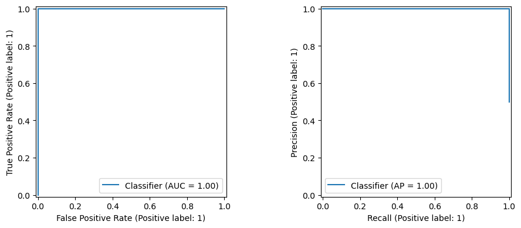
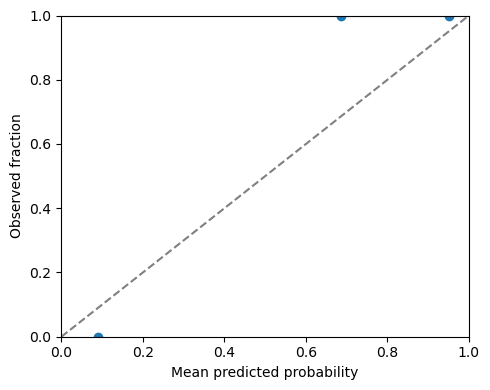

# 课堂操作说明：文件、运行步骤与实验结果解读

本文件集中说明课堂中具体做什么：打开哪些文件、怎样运行、每一步看哪些输出、怎样核对计算及解释实际结果。它对应已经完成的 [实验报告](experiment-report.md) 和 [带输出 Notebook](naive-bayes-lab-completed.ipynb)。基础概念及知识之间的联系另见独立的 [知识清单](knowledge-guide.md)。

## 1　先认清文件，避免打开旧版

| 文件 | 用途 |
|---|---|
| ../slides/naive-bayes-experiment-intro.pptx | 本次21页重点课件 |
| ../student-worksheet.md | 本次已经填完的七项工作单，包含报告图表 |
| ../notebooks/naive-bayes-lab.ipynb | 原始实验，保留不改 |
| naive-bayes-lab-completed.ipynb | 提交副本，已保存本次真实输出和两张图 |
| experiment-report.docx / experiment-report.html | 可独立查看的图文报告，图片嵌入其中 |
| ../data/student/train.csv | 72条，用来估计模型参数 |
| ../data/student/validation.csv | 24条，用来比较表现和选阈值 |
| ../data/student/locked-test-features.csv | 测试输入，没有疾病标签 |
| ../data/teacher/locked-test-labels.csv | 已经教师允许使用的测试标签，仅最终评价时读取 |
| fixed-protocol.json | 最终方案：输入、目标、训练ID、α、阈值、是否重训 |

目录里还有旧版DOCX、旧Notebook和旧课件，不要用它们的结果填本次任务。此次主目标一直是bladder_inflammation，选做nephritis没有运行。

## 2　准备环境与打开文件

在项目根目录 `E:\健康实践\lesson_6` 打开终端，检查Python。若自己配置新环境，按项目建议用Python3.11–3.13：

```powershell
python -m venv .venv
.\.venv\Scripts\Activate.ps1
python -m pip install -r requirements.txt
python -m jupyter lab notebooks/naive-bayes-lab.ipynb
```

若PowerShell不允许激活脚本，可以不更改系统策略，直接用环境中的解释器：

```powershell
.\.venv\Scripts\python.exe -m pip install -r requirements.txt
.\.venv\Scripts\python.exe -m jupyter lab notebooks/naive-bayes-lab.ipynb
```

打开后选择该环境对应的Python内核。VS Code中也可直接打开ipynb，点击右上角“选择内核”。运行单元通常使用 **Shift+Enter**，执行后转到下一格。先保存自己的副本，避免覆盖原始空白实验。

**本次实际环境：**使用本机现有 `D:\ana\a\python.exe`（Python3.12.4），NumPy1.26.4、pandas2.2.2、scikit-learn1.4.2、Matplotlib3.8.4。部分版本低于requirements.txt建议范围，但本次所有核心单元成功执行，主要计算与手算一致。没有修改requirements.txt，也没有把“能运行”描述成“满足全部版本要求”。查看现有结果不需要重新装环境。

自动复现脚本为 `../scripts/complete_student_lab.py`。其中 `--release-confirmed` 只用于已经获准使用测试标签的情形；脚本先执行A–C和冻结记录，再执行D，保留原始Notebook。脚本使用nbclient和nbformat，可从已有Jupyter环境运行：

```powershell
$env:PYTHONNOUSERSITE = '1'
& D:\ana\a\python.exe scripts/complete_student_lab.py --release-confirmed
```

该命令从项目根目录执行，会更新reports中的运行副本、图片和数值证据。平时学习直接使用Jupyter逐格运行即可。复现脚本将Jupyter配置与临时输出放在项目的.tmp目录；本机沙箱不支持内核连接文件的ACL设置，脚本仅对这次本地运行设置Jupyter兼容开关，没有更改系统设置。

## 3　初始化：先理解四个开关

原始Notebook顶部有四个开关：

```python
FREEZE_CONFIRMED = False
OPEN_LOCKED_TEST = False
TRANSFER_FREEZE_CONFIRMED = False
OPEN_TRANSFER_TEST = False
```

第一次做A–C时保持False。它们分别表示主方案已固定、主测试允许打开、第二目标方案已固定、第二目标测试允许打开。True/False是流程提示，不能替代教师许可或正式提交。本次已获许可，运行副本的前两个为True，两个迁移开关仍为False。

初始化还读取train和validation、定义六输入及输出目录，没有拟合模型。`BASE`定位项目根目录；Notebook从项目根目录或notebooks目录打开均可。执行后应看到6个输入字段名。

## 4　A：看数据，先做任务1和任务3

运行A的代码，先观察训练表前5行。每行是一个sample；六个症状列是feature；bladder_inflammation是label。表中保留的ID、原始体温和nephritis用于审计或选做，不表示它们都进入模型。

输出中逐项看：

- `n`：train72、validation24；这是记录数。
- `labels`：train中0有37、1有35；validation两类各12。
- `missing`和`illegal bits`：检查缺失及六输入是否出现0/1以外的值，本次均为0。
- `extra duplicates`：去掉sample_id后的全部列重复，不等于仅六项输入重复。
- `unique profiles`：只比较六输入后的组合数；train为9。
- `validation rows with profiles seen in train`：24，说明新ID仍可能有旧症状组合。

`assert not set(train.sample_id)&set(val.sample_id)`检查ID交集为空。assert不报错表示检查通过，不是“程序没做事”。

此时先理解任务1：给模型的是症状x，想预测的是疾病y；规则必须能把x转成输出。任务2的8条手算小数据在工作单里，**不需要加进CSV**：x=0得到1/3，x=1得到4/5；增加阴性并重训后才变4/6。

## 5　A2：训练模型，再核对一次Bayes计算

核心调用如下：

```python
model = fit_model(train)
x = [0,0,0,1,1,1]
hand, weights, posterior = hand_calculation(train, x)
model.predict_proba(pd.DataFrame([x], columns=FEATURES))[0,1]
```

`fit_model`实际调用BernoulliNB(alpha=1,binarize=None)，仅使用train的六输入和主标签。`fit`从train计数估参；`predict_proba`使用固定参数计算各类别概率。其两列对应classes_里的0、1，`[0,1]`取第一条输入的阳性概率。

复算时按以下顺序，不要一开始就把整个长公式按进计算器：

1. 数类别：n0=37、n1=35，先验为37/72、35/72。
2. 在每类里分别数症状出现次数；例如类0发热25次。
3. 平滑出现概率：类0发热θ=(25+1)/(37+2)=26/39。
4. 对照输入：本例发热x=0，因此用补概率1−26/39=13/39。
5. 为类0相乘六项并乘先验，得w0=0.0005894353613；类1同理得w1=0.0433193284405。
6. 归一化：p=w1/(w0+w1)=0.9865759063；最后才与0.5比较，得到类别1。

为什么分母加2？Bernoulli只有出现/不出现两种结果，各加α=1次。先验在本课仍是nc/n，不照搬成(nc+1)/(n+2)。**本课模型参数**是π与θ，**阈值**是另选的决策设置。

如果结果不符，依次检查：有没有把另一标签混入输入；输入顺序是否相同；x=0是否用了补概率；有没有用train之外数据估参；两个类别是否都乘先验；是否忘记归一化；中间是否过早舍入。

## 6　B：先看损失，再看类别和阈值

先看三行accuracy/log loss表：

| 行 | 你应读到什么 |
|---|---|
| NB_train | accuracy1，log loss0.098840 |
| NB_validation | accuracy1，log loss0.087214 |
| Prior_only_validation | accuracy0.5，log loss0.693533 |

Prior-only输出35/72，小于0.5，所以全部阴性；它不是“随机猜硬币”，而是不使用症状的固定概率基线。NB优于它，说明本数据的症状提供了信息。

然后看混淆矩阵计数与指标。固定行是真实类别、列是预测类别：

`[[TN,FP],[FN,TP]]`。

不要只记缩写：FN是“实际有病却判无病”，FP是“实际无病却判有病”。程序NaN若来自precision的零分母，应写“未定义”，不是0。

再看完整阈值表：0.1时FP5、FN0；0.5时FP0、FN0；0.9时FP0、FN2。所有行的概率来自同一个模型，log loss与排序指标不会因为只改分类阈值而改变。

最后看 `validation-selected threshold: 0.5`。它来自预先规定的多层选择规则，不是先看test后挑的最好成绩。完整表已另存validation-thresholds.csv。



左图ROC看不同阈值下假阳性率与敏感度；右图PR看recall与precision。图中的AUC/AP是排序摘要。本次图接近理想边界，也要继续检查概率和数据来源。它不是主测试集的图。

## 7　C：用复制症状检验假设的影响

C先输出类内依赖的频率对照，再依次对腰痛增加0、1、5个副本。这里只为对照额外拟合dm，不覆盖主模型model；主模型最终仍为原六输入。

找到A094：原p=0.8742623，5份副本后p=0.1452630，固定0.5阈值时从正确阳性变漏诊。它并未多测5次腰痛，只是把同一列复制，说明NB会把冗余证据重复使用。

汇总表中0/1/5份副本的log loss分别约0.087214/0.070425/0.385377。观察说明“重复列能改变概率”，不能把它夸张成“复制一次必然变差”。

最后看可靠性表与图：把预测概率分箱，逐箱比较平均p和真实阳性比例。低概率箱12条平均p=0.089002，实际阳性为0；(0.6,0.8]箱只有1条。空箱NaN表示没有数据，不要补成零。



靠近灰色对角线表示该箱的平均预测与观察频率更接近。样本很少，且只有部分区间有点，不能凭这幅图证明临床校准。

## 8　冻结方案：先把选择写定，再看测试

确认以下项目已经固定：目标bladder_inflammation、原6项输入、α=1、发热界限38°C、训练72条的ID、t=0.5、不合并validation重训。

Notebook冻结单元用这些值生成freeze；`FREEZE_CONFIRMED=True`时写出frozen-protocol.json，然后D才读取标签。提交用的fixed-protocol.json也记录完整方案和训练ID，方便对照。它是本地可审查记录，不是防修改存证，也不代表已经替你向教师提交。

本次你已确认获准使用标签，所以执行了D。若换一个新实验，应先取得相应许可并固定其方案，再打开对应测试；本次许可不等于所有未来任务都已获准。

## 9　D：读懂最终评价，写出结论边界

在前两个开关为True、前面代码按序执行后运行D。D按sample_id一对一合并测试输入与标签，检查测试ID不与train/validation相交，再用原model和固定threshold预测。

读取：TN12、FP0、FN0、TP12；accuracy24/24，sensitivity12/12，specificity12/12；log loss0.074492。分母要和数字一起报告，不能只写“100%”。

`test profiles seen in train: 24`是最关键的限制之一：test是未参与开发的新行，但其输入模式全部见过。因此成绩说明同源已见模式的再现，不能直接推广到未见组合、新医院或新患者。

D还会输出Wilson区间与输入翻转压力测试。这些在源Notebook同一单元里自动生成，属于选做观察，不用于重选阈值。Wilson区间依赖相应统计假设；输入翻转模拟用固定seed和1000次重复，描述人为设定的扰动机制，既不是新增1000位患者，也不是医院真实错误率。核心报告没有把它们当临床证据。

## 10　保存、提交与本人核验

保存Notebook时要保留输出，不要只交空白代码；程序证据、固定方案与报告应使用同一个阈值和目标。本次保留了原始Notebook，提交副本另存。图文报告Word/HTML已嵌入图片，Markdown则依赖相对路径。

建议提交：已完成工作单或图文报告、naive-bayes-lab-completed.ipynb，以及报告中7.4的一页综合说明。fixed-protocol.json和两张CSV可作核验附件；不提交.tmp运行缓存。

本人下一步应实际做三件事：用计算器重算一次后验；在8条教学预测上亲自数TP/FP/FN/TN；口头说明“为什么24/24不能证明临床全对”。通过后再将AI辅助拟答改成自己的表达，更新本人核验状态；不要提前勾选能力自查。

## 常见卡点与处理

| 现象 | 检查或处理 |
|---|---|
| No module named sklearn | 当前内核可能与安装依赖的Python不同；选对内核，再在该环境安装requirements |
| 找不到scripts/lab_utils.py | 从项目根目录或notebooks目录打开，不要单独拷出Notebook后运行 |
| model / threshold未定义 | 单元未按序执行；重启内核，从初始化执行到当前位置 |
| precision显示NaN | 先看TP+FP是否为0；本次基线确实没有预测阳性 |
| C的空箱出现NaN | 空箱没有记录，不代表概率或阳性比例为0 |
| 手算差较大 | 先检查输入顺序和无症状补概率，再检查平滑、先验与归一化 |
| test成绩很好但不知怎么解释 | 同时报分母和模式重叠，避免把专家构造记录当临床队列 |

以上说明按本次真实实验编写。你不理解的概念可以直接用“知识清单第几步／工作单第几题”继续问。
