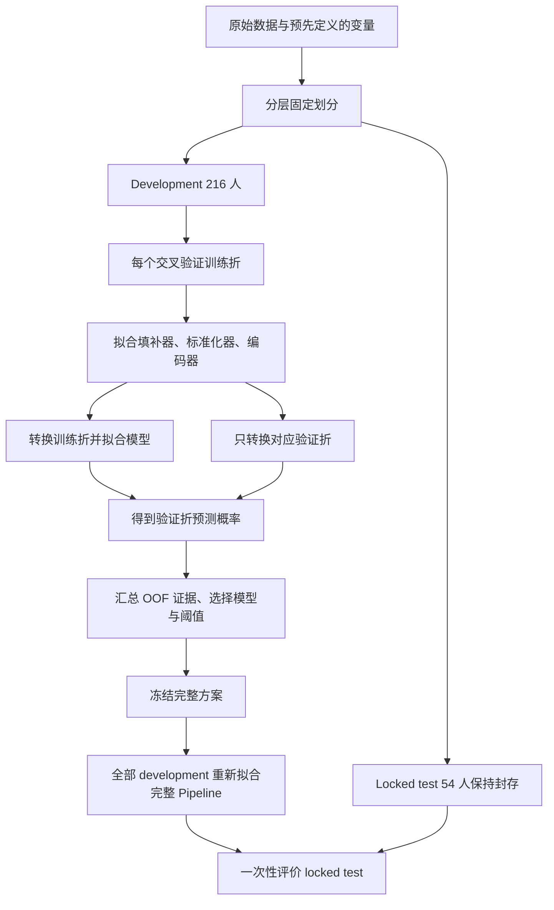

# 第 8 讲知识清单：线性模型、LDA 与 Logistic Regression

> 学习目标：能解释模型怎样产生概率，能完成课堂九项任务，并能用证据说明方法选择的理由与边界。
>
> 主要依据：[15 页课堂课件](../slides/linear-models-pbl-intro.pptx)与[课堂工作单](../materials/student-worksheet.md)。同时核对了当前数据和 `notebooks/linear-models-lab.ipynb` 的预处理设置。本文中的演算例子均为教学示例；没有运行模型比较、选择实际阈值或打开 locked test。工作单中的实验结果仍需你自己运行后填写。

## 如何使用这份清单

每一部分按“直觉 → 公式 → 例子 → 会做什么”学习。第一次先理解，不必背所有矩阵公式；第二次关掉笔记，回答末尾自测；第三次带着问题运行课堂 Notebook。

建议把掌握程度记为：`0=不认识；1=看得懂；2=能独立解释；3=能用实验论证`。课堂核心知识至少达到 2，实验相关内容达到 3。

### 与课件、工作单的对应关系

| 知识模块 | 对应课件页 | 对应工作单任务 | 学会后的可见产出 |
|---|---|---|---|
| 建模对象、参数、目标与概率来源 | 2–3、5–7、10 | 1、3、4、6 | 完成两种模型对照表 |
| 线性评分、系数与边界 | 4–5、7 | 2 | 解释一个评分和一次阈值移动 |
| 编码、参数量与样本量 | 3、8–10 | 3、4、6 | 计算编码后的维度及参数量 |
| 数据审计与无泄漏验证 | 8–9、14 | 5 | 变量表和训练折内 Pipeline 图 |
| 区分、概率质量、阈值错误 | 11 | 6、7 | 多指标证据表 |
| 错误代价与阈值冻结 | 12、14 | 7、9 | 代价曲线、冻结方案 |
| 系数、共线性与假设压力 | 6–7、13 | 8 | OR 解释、稳定性和假设诊断 |
| 方法选择与结论边界 | 2、10、15 | 9 | CERB 论证和退出卡 |

### 必须会回答的八个问题

- [ ] 两个模型分别建模什么、假设什么、估计什么？
- [ ] 为什么都可能产生线性边界，且都能输出概率？
- [ ] one-hot 后维度怎样变化，为什么协方差参数增长快？
- [ ] probability、odds、logit、系数、OR 分别是什么？
- [ ] 如何保证预处理、模型比较和阈值选择不泄漏？
- [ ] AUC、校准、概率损失和阈值错误各回答什么问题？
- [ ] 为什么预测稳定不保证单个系数稳定？
- [ ] 为什么内部预测结果不能直接支持因果和临床部署结论？

---

## 1. 先补齐公式中的基本对象

### 1.1 一行数据、一列变量和一个标签

本课是二分类：`Y=1` 表示心脏病存在，`Y=0` 表示不存在。

| 符号 | 含义 | 直觉 |
|---|---|---|
| n | 当前用于拟合的记录数 | 有多少名受试者 |
| x_j | 一个特征的取值 | 某人的年龄或某个类别指示值 |
| x | 一个人全部编码后特征组成的向量 | 数据表中的一行输入 |
| X | 所有人的输入矩阵 | 行是人，列是编码后的变量 |
| q | 编码后的输入列数 | 不一定等于原始的 13 项 |
| β₀ | 截距 | 输入取编码零点时的基准评分 |
| β_j | 第 j 个特征的系数 | 特征变化如何影响评分 |
| p | P(Y=1\|x) | 已知这组特征时，模型给出的阳性概率 |
| μ_k | 第 k 类特征均值向量 | 该类的中心 |
| Σ | 协方差矩阵 | 各变量的波动和共同变化 |
| π_k | P(Y=k) | 还没观察特征前的类别概率 |

`xᵀβ` 就是逐项相乘后求和，不需要先掌握复杂矩阵计算。

### 1.2 概率、条件概率、密度、先验与后验

- `P(Y=1)`：先不看个人检查指标时的阳性比例。
- `P(Y=1|x)`：看过此人的检查指标后得到的阳性概率。
- `f_k(x)=p(x|Y=k)`：在第 k 类人中，类似这组检查指标的数据有多常见。

连续变量的**密度值不是某一点的概率**，可以大于 1；连续区间下的面积才是概率。LDA 先算类条件密度，再经 Bayes 归一化得到类别概率。

“先验”与“后验”在这里表示观察 x 前后的类别概率。LDA 使用 Bayes rule，并不意味着本课采用了对参数进行贝叶斯推断的完整流程。

### 1.3 方差与协方差要懂到什么程度

以两个特征为例：

$$
\Sigma=\begin{pmatrix}
\operatorname{Var}(X_1)&\operatorname{Cov}(X_1,X_2)\\
\operatorname{Cov}(X_1,X_2)&\operatorname{Var}(X_2)
\end{pmatrix}
$$

对角线是各特征的方差；非对角线表示共同变化。LDA 假设各类共享整个协方差矩阵，**不要求各变量相互独立**。共享协方差也不意味着两类均值相同。

### 1.4 不要混淆三个名字

| 方法 | 主要建模对象 | 常见输出与目标 |
|---|---|---|
| Linear regression：线性回归 | 连续结局的条件均值 E(Y\|X) | 实数预测，常用平方误差 |
| Logistic regression：逻辑回归 | 二分类条件概率 P(Y=1\|X) | 0–1 概率，常用交叉熵 |
| LDA：线性判别分析 | 类条件分布 P(X\|Y) 与先验 P(Y) | 判别分数、类别概率及分类 |

Logistic 名字里有 regression，本课却用它完成分类。直接把普通线性回归的预测值当概率，可能得到小于 0 或大于 1 的数。

**掌握检查：**解释“LDA 中的线性指什么”，而不是回答“所有输入都必须是直线关系”。

---

## 2. 共同起点：线性评分与决策边界

对应课件第 4 页；工作单任务 2。

### 2.1 线性评分在做什么

$$z=\beta_0+\mathbf{x}^{T}\boldsymbol\beta
=\beta_0+\beta_1x_1+\cdots+\beta_qx_q$$

它把多个输入压缩成一个实数。其他变量固定时，正系数让输入增大时 z 增大，负系数让 z 减小。

例如：`z=-3+0.04×年龄+0.8×运动诱发心绞痛指示值`。

一名 50 岁、指示值为 1 的人的评分为 `-3+2+0.8=-0.2`。这个评分还不是概率。

### 2.2 为什么叫线性边界

所有满足 `β₀+xᵀβ=c` 的输入组成边界：二维时是直线，三维时是平面，更高维称超平面。

Logistic 的概率阈值为 t 时：

$$p\ge t\quad\Longleftrightarrow\quad
z\ge\log\frac{t}{1-t}$$

| 概率阈值 t | 评分阈值 log[t/(1−t)] |
|---:|---:|
| 0.5 | 0 |
| 0.2 | 约 −1.386 |
| 0.8 | 约 1.386 |

在已拟合参数固定的前提下，改变阈值会平行移动行动边界，方向不变；重新训练改变系数，则可能改变方向与位置。对固定的二分类 LDA 概率，也有对应的线性分数阈值。

“线性”是对**模型输入特征**而言。若你增加年龄平方或交互项，模型仍对这些编码特征线性，但在原始年龄等坐标中可以出现曲线边界。本课不要求展开这一扩展。

### 2.3 为什么不能直接说“系数越大越重要”

比较之前必须说明：

1. **单位**：年龄按 1 年还是 10 年？
2. **标准化**：增加 1 是 1 岁，还是训练数据中的 1 个标准差？
3. **参照水平**：胸痛类型与哪一类比较？
4. **调整变量**：模型中同时放了哪些相关特征？
5. **不确定性**：系数及 OR 的区间有多宽？

标准化后的系数可以改善尺度可比性，但仍不自动等于变量的重要性或因果强度。

**你应该能做：**给定一个评分公式，算出 z；给定 t，写出边界；解释降低 t 为什么不需要重新估计 β。

---

## 3. Logistic regression：从评分到概率，再到参数估计

对应课件第 5、13 页；工作单任务 1–3、8。

### 3.1 sigmoid、odds、logit 的关系

$$p=\sigma(z)=\frac{1}{1+e^{-z}},\qquad
\operatorname{odds}=\frac{p}{1-p},\qquad
\operatorname{logit}(p)=\log\frac{p}{1-p}=z$$

| z | p（约） | odds（约） |
|---:|---:|---:|
| −2 | 0.119 | 0.135 |
| 0 | 0.500 | 1 |
| 2 | 0.881 | 7.389 |

Sigmoid 把任意实数压到 0–1，并且单调递增。因此它不改变评分排序。Logistic 的线性假设是 **log-odds 是输入的线性函数**，不是概率本身与年龄等输入线性。

### 3.2 模型究竟在估计什么

它直接建模：

$$Y_i\mid x_i\sim\operatorname{Bernoulli}(p_i),\qquad
p_i=\sigma(\beta_0+x_i^T\beta)$$

对于真实阳性，希望 p 大；对于真实阴性，希望 1−p 大。条件似然为：

$$L(\beta_0,\beta)=\prod_{i=1}^n p_i^{y_i}(1-p_i)^{1-y_i}$$

最大化它，等价于最小化负对数似然，即二分类交叉熵：

$$\mathcal L=-\sum_{i=1}^{n}
\left[y_i\log p_i+(1-y_i)\log(1-p_i)\right]$$

例如真实标签为 1：给出 p=0.9，单例损失约 0.105；给出 p=0.1，损失约 2.303。**自信地预测错误会受到较重惩罚。**

因此“调用 fit”背后的意思是：算法迭代寻找截距和系数，让训练数据上的总交叉熵变小。这里不要求背求导步骤。

### 3.3 理论目标与课堂代码的一点区别

课堂精简 Notebook 使用 `LogisticRegression(max_iter=3000)`，未显式关闭正则化；按常见 scikit-learn 默认设置，它带有 L2 正则化。其思想是：

$$\text{目标}=\text{交叉熵}+\lambda\lVert\beta\rVert_2^2$$

具体缩放随实现约定而异。惩罚项抑制过大的系数，可能改善小样本或共线性下的稳定性；代价是引入收缩。`C` 越小通常表示正则化越强。惩罚不会把输入列数变少，但会影响有效复杂度。

因此应区分：无惩罚 logistic 的最大条件似然，以及软件实际采用的带惩罚目标。完全分离时，无惩罚系数可能无限增大；这也是正则化可能有用的原因。

### 3.4 OR 应怎样解释

若其他建模变量固定，特征 x_j 增加 Δ 个建模单位：

$$OR(\Delta)=e^{\beta_j\Delta}$$

当 Δ=1 时，`OR=e^βj`。

假设标准化年龄的 β=0.4，`OR≈1.49`。合格表述是：

> 在该模型包含的其他变量固定时，年龄增加一个训练数据标准差，与心脏病存在的 odds 乘以约 1.49 相关。该结果是模型中的条件关联。

如果模型输入是标准化年龄，这就不是“每增加 1 岁”。若年龄原单位系数为 β，则增加 10 岁的 OR 是 `exp(10β)`。

截距的基准概率是 `σ(β₀)`：数值特征取编码零点、分类变量取参照时的预测。标准化后零通常是训练均值；这个基准不必等于总体患病率。

### 3.5 为什么 OR=2 不等于概率翻倍

若原概率为 p₀，odds 乘以 r 后：

$$p_1=\frac{r p_0}{1-p_0+r p_0}$$

| 原概率 p₀ | 原 odds | OR=2 后 odds | 新概率 p₁ |
|---:|---:|---:|---:|
| 0.20 | 0.25 | 0.50 | 0.333 |
| 0.50 | 1 | 2 | 0.667 |

概率变化依赖起点。在罕见结局等特定条件下 OR 可以近似某些风险比，但不能默认把两者替换。

**掌握检查：**能完整解释一个 OR，明确单位、比较对象、其他变量固定和关联边界；能说出 logistic 不要求各类 X 都服从正态分布，但仍有模型形式等假设。

---

## 4. LDA：从每一类的数据分布得到后验概率

对应课件第 6–7 页；工作单任务 1、4、6、8。

### 4.1 先问“这一类人通常长什么样”

$$X\mid Y=k\sim\mathcal N(\mu_k,\Sigma),\qquad P(Y=k)=\pi_k$$

- **μ_k：**每一类的特征中心，两类通常不同。
- **Σ：**类内的方差与相关结构，各类共享。
- **π_k：**类别先验，通常由训练数据比例估计，也可依据任务预先指定。

“多元正态”是类内联合分布的假设。只看所有人合并后的直方图不能检验它；只看各变量的一维直方图也不能充分证明联合正态。

本课有二元、名义和计数变量；one-hot 列并不严格服从连续高斯分布。因此 LDA 在这里是带有近似假设的教学比较对象，需要看实际预测、概率质量和稳定性证据。

### 4.2 概率从哪里来

设第 k 类的类条件密度为 f_k(x)，则：

$$P(Y=k\mid x)=\frac{\pi_k f_k(x)}{\sum_{\ell}\pi_{\ell}f_{\ell}(x)}$$

例：若 `π₁=0.4, f₁(x)=0.3, π₀=0.6, f₀(x)=0.1`，则：

$$P(Y=1\mid x)=\frac{0.4\times0.3}{0.4\times0.3+0.6\times0.1}=\frac23$$

这里 0.3、0.1 是示意密度值，不是类别后验。类别后验来自“密度×先验”之后的归一化。

### 4.3 参数怎样估计

常规 LDA 根据带标签训练数据估计：

1. 各类内的样本均值 μ_k；
2. 把类内波动汇总得到的共享协方差 Σ；
3. 训练类别比例 π_k，除非预先给定先验。

它对应类条件高斯与类别先验的联合似然估计，很多参数有直接的样本统计估计式；不同实现对协方差的分母、收缩与数值求解会有区别。它不是像 logistic 那样直接最小化同一个条件交叉熵来寻找自由的分类系数。

### 4.4 为什么最后仍然是线性边界

先看高斯对数密度里的关键项：

$$-\frac12(x-\mu_k)^T\Sigma^{-1}(x-\mu_k)$$

展开：

$$-\frac12x^T\Sigma^{-1}x
+x^T\Sigma^{-1}\mu_k
-\frac12\mu_k^T\Sigma^{-1}\mu_k$$

各类共享 Σ，因此第一项对于各类相同。在比较两个类别时它抵消；共享的行列式项等也抵消。留下判别分数：

$$\delta_k(x)=x^T\Sigma^{-1}\mu_k
-\frac12\mu_k^T\Sigma^{-1}\mu_k+\log\pi_k$$

二分类分数之差为：

$$\delta_1(x)-\delta_0(x)=a+x^Tw,\qquad
w=\Sigma^{-1}(\mu_1-\mu_0)$$

所以边界是线性的。方向取决于两类均值差，也取决于噪声和相关结构。上式用可逆协方差说明原理；遇到冗余列或奇异矩阵，实际实现需要降维、SVD、收缩等处理。

二分类 posterior 还可以写成：

$$P(Y=1\mid x)=\sigma\!\left(\delta_1(x)-\delta_0(x)\right)$$

**LDA 和 logistic 都可能写成 sigmoid(线性评分)，但线性评分的估计来源不同。**

### 4.5 一维例子：把整个过程连起来

设 `X|Y=0 ~ N(0,1)`，`X|Y=1 ~ N(2,1)`，两类先验各为 0.5。

此时 `δ₁(x)−δ₀(x)=2x−2`，所以 `p=σ(2x−2)`。

- x=0，p≈0.119；
- x=1，p=0.5，是默认阈值的边界；
- x=2，p≈0.881。

这条 sigmoid 的系数由均值、共同方差和先验推出来，而不是直接对条件交叉熵拟合出来。

### 4.6 如果每一类协方差不同呢

允许 `Σ₀≠Σ₁` 时，二次项通常不再抵消，得到 QDA（Quadratic Discriminant Analysis）。它更灵活，但要估计更多协方差参数，小样本时可能更不稳定。特殊参数情形下边界仍可能简化；“通常为二次”比“必定为曲线”更准确。

**掌握检查：**画出 `类内分布+先验 → Bayes → 后验概率`；复述二次项为何抵消；解释为什么 LDA 既不等于“不能给概率”，也不等于“要求特征独立”。

---

## 5. 最关键的比较：对象、假设、目标与参数量

### 5.1 可用于工作单任务 1 的对照表

| 维度 | Logistic regression | LDA |
|---|---|---|
| 直接建模对象 | P(Y=1\|X) | P(X\|Y=k) 与 P(Y=k) |
| 建模路线 | 判别式 | 生成式 |
| 主要参数 | 截距 β₀、系数 β | 各类 μ_k、共享 Σ、先验 π_k |
| 从什么关系估计 | 标签与特征之间的条件关系 | 每类内部特征分布及类别比例 |
| 常规估计目标 | 最大条件似然／最小交叉熵；可加惩罚 | 类条件高斯与先验的联合似然估计 |
| 概率来源 | 线性 logit 经 sigmoid | 密度×先验经 Bayes 归一化 |
| 线性边界来源 | 预设 log-odds 线性 | 共享协方差使二次项抵消 |
| 对输入分布的要求 | 无需完整指定 X\|Y 的分布 | 类内联合高斯、共享协方差等 |
| 主要关注点 | logit 形式、编码、正则化、共线性 | 高斯近似、协方差、先验、维度与样本量 |

两者都需要合理的数据来源与验证，常规分析都需关注观测独立性。重复测量、同一患者多条记录或医院聚集可能需要分组设计，不能只靠普通随机分层解决。

### 5.2 为什么 13 个输入不等于 13 个系数

有 K 个类别的名义变量，参考水平编码通常使用 K−1 列；保留全部 one-hot 水平则使用 K 列。

本课精简 Notebook 把 5 项视为数值变量，其余 8 项 one-hot。当前数据的非缺失类别为：

| 变量 | 非缺失水平数 K | 参考编码 K−1 列 | 全部编码 K 列 |
|---|---:|---:|---:|
| sex | 2 | 1 | 2 |
| cp | 4 | 3 | 4 |
| fbs | 2 | 1 | 2 |
| restecg | 3 | 2 | 3 |
| exang | 2 | 1 | 2 |
| slope | 3 | 2 | 3 |
| ca | 4 | 3 | 4 |
| thal | 3 | 2 | 3 |
| 分类列合计 | 23 | 15 | 23 |
| 加上 5 项数值输入后的 q | — | **20** | **28** |

这里类别数是对当前文件的审计，不代表可以为了建模而用 locked test 学习预处理。实际各训练折只在训练数据拟合编码器，并检查 `get_feature_names_out()`；若训练折缺少某水平，输出维度可能变化。上表假定训练折包含这些非缺失水平。

### 5.3 参数量怎样算

二分类、q 维、非冗余输入的常规计数：

- Logistic：截距 1 个，系数 q 个，共 **q+1**。
- LDA：均值 **2q**；共享协方差 **q(q+1)/2**；两类先验只有 **1** 个独立参数，因为 π₀+π₁=1。
- QDA：均值 **2q**；两份协方差 **q(q+1)**；独立先验 **1**。

协方差矩阵是对称的，所以只需计对角线及一半非对角线。

| 编码方式 | q | Logistic 储存系数数（含截距） | LDA 常规参数条目 | QDA 常规参数条目 |
|---|---:|---:|---:|---:|
| 删去每组一个参照水平 | 20 | 21 | 40+210+1=**251** | 40+420+1=**461** |
| 保留全部 one-hot 水平 | 28 | 29 | 56+406+1=**463** | 56+812+1=**869** |

**必须补充的条件：**全水平 one-hot 加截距存在精确冗余；同组指示列之和恒为 1。因此第二行是按列数计算的储存／名义条目数，不能直接称为独立可辨识参数数。LDA 协方差也会出现奇异性。惩罚或 SVD 可以处理部分数值问题，却不会让原始冗余消失。

若课程问“通常的自由参数量”，最清楚的回答是先写明参考编码 q=20，再给出 21 与 251，并说明当前精简 Notebook 的默认编码不同。若先验固定而不从训练数据估计，则 LDA/QDA 的估计参数量不再加那 1 个先验参数。

### 5.4 全水平编码时，OR 要额外小心

参考编码下，某一类别系数相对被省略的水平解释，OR 为 `exp(β_k)`。

全水平编码下，从类别 a 切换到 b，是一个指示列从 1 变 0、另一个从 0 变 1，比较的是：

$$OR_{b:a}=\exp(\beta_b-\beta_a)$$

不能把每个 dummy 的 `exp(β_k)` 都叫作“相对某个已省略参照的 OR”，因为代码没有省略那个参照。

### 5.5 参数多是否就一定更差

不是。参数量说明估计负担和潜在不稳定性，需要结合结构假设、冗余、正则化、样本量及验证证据。LDA 虽估计更多生成模型参数，但共享协方差也是一种约束；在合适的数据条件下可以表现很好。

真正的增长差异是：logistic 的系数数量随 q 大致线性增长，常规 LDA 的协方差条目随 q 大致平方增长。不能仅凭“参数多”宣布某模型失败。

**掌握检查：**能解释为什么四分类变量通常增加三列；能手算 q=20 时两种模型的参数量；能说明全水平编码的计数与 OR 陷阱。

---

## 6. 数据审计与无泄漏流程

对应课件第 8–9、14 页；工作单任务 5。

### 6.1 先确认这份文件实际包含什么

当前 `data/heart.csv` 有 270 行，阳性 120、阴性 150，阳性比例约 44.4%。这是样本比例，不能直接等同于一般人群患病率。

本课固定采用分层 80% development／20% locked test，`random_state=2026`。按类别数计算，开发集为 216 人（96 阳性、120 阴性），测试集为 54 人（24 阳性、30 阴性）。这些是划分规模，不是模型结果。

输入仅为工作单列出的 13 项：

| 课堂代码处理方式 | 变量 | 需要注意 |
|---|---|---|
| 数值输入，填补后标准化 | age、trestbps、chol、thalach、oldpeak | 单位与异常值；OR 的标准化单位 |
| 分类输入，填补后 one-hot | sex、cp、fbs、restecg、exang、slope、ca、thal | 数字编码不等于连续尺度；参照水平 |

`ca` 具有计数性质、`slope` 具有顺序含义，但这份精简代码统一把它们归入分类处理。这样不强加每增加 1 的线性效应，但会增加列数。编码选择需要说明理由。

不能直接作为输入的列：

- `heart_disease_present`：要预测的标签本身。
- `num`：原始疾病状态字段，包含与目标直接相关的信息，会形成目标泄漏。
- `sample_id`、`record_id`：记录标识，不能当作有意义的生理特征；还应检查重复记录。
- `site`：本课固定协议不把站点作为输入。它可能携带来源差异；应作为来源偏倚和泛化审计信息。其他研究若要使用站点，需要另行说明目标与验证设计。

### 6.2 当前文件与课堂文字有一处不一致

课件第 8 页与工作单描述为“无缺失”，但当前 CSV 的空值计数如下：

| 字段 | 空值数 / 270 |
|---|---:|
| trestbps | 22 |
| chol | 9 |
| fbs | 25 |
| thalach | 21 |
| exang | 21 |
| oldpeak | 24 |
| slope | 103 |
| ca | 181 |
| thal | 151 |

这些是当前文件的直接审计结果。作答时应如实记录，并注明与教学描述不一致。精简 Notebook 已包含数值中位数填补、分类众数填补；它们也必须只在训练折拟合。填补让算法能够计算，不代表恢复了真实值或消除了缺失偏倚，尤其应注意缺失比例很高的列。

### 6.3 development、validation、test 各负责什么

- **development：**用来训练、比较模型、检查假设、选择超参数和阈值。
- **validation fold：**开发集交叉验证中，本轮暂不参加训练的那一折，用于得到样本外预测。
- **locked test：**整个方案冻结后的最终内部评价，不参与上述选择。

五折交叉验证不是训练五次后挑最好的一次。每轮用四折拟合，预测剩余一折；最终每名开发集受试者获得一次未参与其自身训练的预测，称 OOF（out-of-fold）预测。

### 6.4 正确的数据流



标准化的公式是 `x*=(x−训练均值)/训练标准差`。验证折和测试集只能使用训练得到的均值、标准差；不能各自重新计算后再评分。

在全数据上标准化后再交叉验证，已经让训练流程使用了验证折的分布信息。即使没使用标签，也是泄漏。先在全部 development 标准化再做其中的交叉验证，同样存在折间泄漏。

`Pipeline` 和 `ColumnTransformer` 的作用，是让每次交叉验证的 `fit` 都在当前训练折重新拟合整条处理链。填补、特征选择、编码、标准化及模型都应遵守这一边界。

### 6.5 交叉验证也有能力边界

重复查看开发结果并选择模型与阈值，会让开发集上最优的结果偏乐观。locked test 用于最终检查；若要严谨估计整个调参过程的性能，可用嵌套交叉验证。

当前精简 Notebook 是一次分层五折；部分课程说明写的是重复分层交叉验证。提交时应写实际执行的折数与重复次数，不能把“一次五折”写成“五次重复”。

**掌握检查：**能画出以上数据流；能指出填补、标准化和编码分别在哪里 fit、在哪里只 transform；能解释为什么 `random_state` 保证复现，却不保证结果适用于所有划分。

---

## 7. 四个比较对象各自提供什么参照

对应课件第 10 页；工作单任务 6。

| 方法 | 基本做法 | 用来检查什么 |
|---|---|---|
| Prevalence baseline | 所有人都给出训练阳性比例 | 模型是否超越“不看个人特征”的预测 |
| Gaussian NB | 各类内每个特征高斯，给定类别时特征独立 | 较强独立性假设的生成式基线 |
| LDA | 类条件联合高斯，共享完整协方差 | 相关结构、共享协方差与线性判别 |
| Logistic | 直接拟合线性 logit | 条件概率路线与系数解释 |

Gaussian NB 中的“独立”是**给定类别后的条件独立**，不是说整个样本里所有变量都毫无相关。常规 Gaussian NB 可以让不同类别有不同的各特征方差，因此不必产生线性边界。

one-hot 同组列存在约束，通常不符合 NB 的条件独立；二元列也不是严格连续高斯。这些都是需要观察预测后果的假设压力，不能因模型名字里有 Gaussian 就忽略。

严格的交叉验证基线也应只从每个训练折估计患病比例。固定常数预测的 ROC-AUC 为 0.5（评价集中两类都存在时），即使样本多数为阴性、accuracy 不低，也没有个人层面的排序区分能力。

**方法选择的条件式说法：**

> 如果类内高斯与共享协方差近似可接受、协方差估计稳定，且验证中的概率质量与代价合适，LDA 有使用理由；如果不希望为 X 的分布作完整高斯建模，而线性 logit 与适当正则化较合理，可以优先考虑 logistic。最终仍要检查样本量、编码、校准、稳定性和任务代价。

这是一条待验证的选择规则，不是“LDA 永远适合小样本”或“混合变量必须选 logistic”的定律。

---

## 8. 模型评价：排序、概率、行动和不确定性

对应课件第 11 页；工作单任务 6–9。

### 8.1 混淆矩阵与四个基本指标

以心脏病存在为阳性，表格的轴一定要注明：

| 真实情况 ↓ / 预测类别 → | 预测阳性 | 预测阴性 |
|---|---:|---:|
| 实际阳性 | TP：检出 | FN：漏诊 |
| 实际阴性 | FP：误报 | TN：正确排除 |

$$\text{Sensitivity / Recall}=\frac{TP}{TP+FN}$$

$$\text{Specificity}=\frac{TN}{TN+FP},\qquad
\text{Precision / PPV}=\frac{TP}{TP+FP}$$

$$\text{Accuracy}=\frac{TP+TN}{n},\qquad
\text{FPR}=\frac{FP}{FP+TN}=1-\text{Specificity}$$

- Sensitivity：真正患病的人中，抓住多少？
- Specificity：真正未患病的人中，正确排除多少？
- Precision：被预测为阳性的人中，真正阳性多少？

Precision 与 sensitivity 分母不同；FP 数与 FPR 也不同。Precision 会明显受到目标人群患病率影响，不能把一个样本的 PPV 原样搬到另一人群。

### 8.2 ROC-AUC：看排序

ROC 曲线考察不同阈值下的 TPR（sensitivity）和 FPR；ROC-AUC 可以理解为：随机取一名阳性和一名阴性，阳性评分更高的概率，并对同分计一半。

- 越大通常表示排序区分越好，随机排序约为 0.5。
- 它不告诉你某个病人的概率是否准确。
- 它不自动给出成本最小的阈值，也不保证阈值 0.5 的表现。
- 固定模型的原始概率不变时，仅改变最终分类阈值不会改变 ROC-AUC。

### 8.3 PR 曲线与 average precision

PR 曲线展示不同阈值下 precision 与 recall 的权衡，尤其便于观察较少阳性时的检出与误报负担。

本课代码里的 `pr_auc` 实际由 `average_precision_score` 计算，即 **AP（average precision）**。AP 与用梯形积分得到的 PR-AUC 不完全相同，报告时最好注明采用 AP，避免混用定义。

AP 会受阳性比例影响；不同患病率数据集之间的数值不能轻率比较。在随机排序意义下，其参照水平与阳性比例有关。

### 8.4 Brier score 与 log loss：看概率误差

$$\operatorname{Brier}=\frac1n\sum_i(p_i-y_i)^2$$

$$\operatorname{LogLoss}=-\frac1n\sum_i
[y_i\log p_i+(1-y_i)\log(1-p_i)]$$

两者通常都是越低越好。Log loss 对高置信度的错误特别敏感；Brier 是概率与 0/1 结果的平方误差。

两者都是综合概率评分，**不能简单称为纯校准指标**。它们同时反映校准和区分等方面；应结合校准图与排序指标理解。

### 8.5 什么是校准

如果模型对一群类似的人给出约 0.7 的风险，这群人在相应目标与观察窗口下应有约 70% 为阳性，这叫概率与实际频率相符。

校准曲线／reliability diagram 比较“平均预测概率”和“观察到的阳性比例”，理想情况接近对角线。但小样本分箱很不稳定，特别是本课只有 54 人的测试集，不能只看一条曲线就作强结论。

把所有概率改为 `p²` 是严格单调的变换，通常保留排序和 ROC-AUC，却改变概率数值、概率损失、校准及固定阈值错误。这说明它们不能互相替代。

如果要拟合概率校准器，它也是训练流程的一部分，不能用 locked test 拟合后再把同一测试表现当作独立评价。

### 8.6 Bootstrap：不要只盯着一个小数

Bootstrap 的基本做法是从当前评价样本中**有放回地抽取同样数量的记录**，反复计算统计量，用重抽样分布了解不确定性。

两种用途需要区分：

| 用途 | 每次重抽什么 | 是否重新训练 | 回答的问题 |
|---|---|---|---|
| 固定模型的测试指标区间 | 测试样本的标签与预测，成对抽取 | 通常不重新训练 | 这批测试样本带来的评价波动有多大？ |
| 系数稳定性 | 开发数据中的受试者 | 重新拟合完整预处理与模型 | 换一批相似训练记录，系数会怎样变化？ |

比较两个模型时，应对同一批测试索引做配对重抽样，考察指标差值的区间；不能只凭两个点估计或“两个区间是否重叠”判断差异。

例如用重抽样分布的 2.5% 与 97.5% 分位数作近似 95% 区间。抽样单位必须与数据结构匹配；若有重复患者或聚集结构，可能需要按患者／群组抽样。AUC 还要求重抽样样本中存在两类，必要时采用分层重抽样。

固定模型的测试 bootstrap 区间没有囊括重新选模型、重新调参等全部不确定性，也不证明外部人群有效。它不是“个体有 95% 概率落在这个指标区间”。

**掌握检查：**能对同一模型分别回答“排得准吗”“概率可信吗”“该阈值漏了多少”“结果有多不稳定”。

---

## 9. 阈值与错误代价：从概率走到行动

对应课件第 12 页；工作单任务 7、9。

### 9.1 本课的目标函数

$$\operatorname{Cost}(t)=5\,FN(t)+FP(t)$$

这是课堂规定的相对错误代价：漏掉一名阳性，按误报一名阴性的五倍计算。它不表示真实医学代价已被完整测定。

降低阈值会让更多人被判为阳性。在固定概率与数据下，FN 不增、FP 不减；但总成本可能上升，也可能下降，取决于两者的变化幅度。

### 9.2 手算例子：更低阈值不保证成本更低

**以下是手工构造的 100 人示例，与课堂 locked test 无关。**设有 20 阳性、80 阴性：

| 阈值 | TP | FN | FP | TN | Sensitivity | Specificity | 5FN+FP |
|---:|---:|---:|---:|---:|---:|---:|---:|
| 0.5 | 18 | 2 | 16 | 64 | 0.90 | 0.80 | 26 |
| 0.2 | 19 | 1 | 28 | 52 | 0.95 | 0.65 | 33 |

第二行少漏一人，却多误报十二人，总成本增加。阈值必须用任务目标和验证证据选择，不能只追求 sensitivity。

### 9.3 为什么理论上常会出现 1/6

如果 p 是**目标人群中已校准的真实风险**，并且只有 FN 与 FP 有代价、正确分类代价为零：

- 判为阳性的期望成本：`1×(1−p)`；
- 判为阴性的期望成本：`5×p`。

选择阳性，当 `1−p≤5p`，即：

$$p\ge\frac{1}{6}\approx0.167$$

一般形式是 `t=C_FP/(C_FN+C_FP)`。这给出一个有条件的决策直觉，**不是要求你把本课经验最优阈值直接填成 0.167**。实际模型有估计误差，样本有限，概率可能失准；精简代码还只比较 0.1–0.9 的离散候选阈值。因此应按课程协议用开发集 OOF 概率比较、记录并冻结阈值。

若改变目标人群患病率、采用类别权重或重采样，原始输出未必仍代表目标人群风险，需要重新审查上述条件。重新训练带权模型与只改变预测阈值是两件事。

### 9.4 什么必须冻结

- 输入变量和缺失处理、编码、标准化方法；
- 模型类型、超参数与必要的概率校准方法；
- 阳性定义、分类规则（如 p≥t）与阈值；
- 错误代价、评价指标和不确定性计算方法。

冻结后，在全部 development 拟合完整 Pipeline，再对 locked test 评价。若查看测试结果后修改方案，测试集已经参与选择，需要新的独立评价。

**掌握检查：**能同时解释“漏诊代价高为何倾向较低阈值”和“为何不能凭这句话确定实际最优阈值”；能说出单独改阈值不改变参数、原始概率、ROC-AUC、AP、Brier 或 log loss。

---

## 10. 共线性、系数稳定与假设压力

对应课件第 13 页；工作单任务 8。

### 10.1 为什么预测稳定，系数却不稳定

给年龄添加一个近重复变量：

$$\text{age\_duplicate}=\text{age}+\text{很小的随机噪声}$$

模型中两项贡献为：

$$\beta_1\,\text{age}+\beta_2\,\text{age\_duplicate}
\approx(\beta_1+\beta_2)\,\text{age}$$

很多不同的 β₁、β₂ 组合都能得到相近评分。例如 0.4+0.1 与 1.2−0.7 的合计相同。模型可能在两个高度相关变量间重新分配系数，而总体预测相近。

因此需要分别检查：

- **预测稳定性：**不同重抽样或扰动下的预测概率、AUC、Brier、代价等是否稳定。
- **解释稳定性：**各系数符号、大小、OR 与区间是否稳定。

正则化可能减少波动，但不能把两个近重复测量自动解释成两种独立机制。“其他变量固定”对于高度相关特征也可能对应现实中几乎不存在的比较。

### 10.2 系数 bootstrap 的最小合格流程

1. 只在 development 中有放回地抽取受试者。
2. 每次重新拟合预处理与 logistic。
3. 对齐特征名称、类别水平与参照，记录系数或可比较的类别对比。
4. 保证比较单位一致。若每次标准化的 SD 不同，可将系数换回原单位，或换算到同一个预先定义的尺度再比较。
5. 查看符号翻转、分布宽度和 OR 区间，并与预测指标的变化对照。

对带惩罚估计的 bootstrap 区间，应描述为该估计流程下的稳定性／不确定性证据，不能自动套用无惩罚模型的经典推断解释。

### 10.3 LDA 的假设怎样检查

| 检查对象 | 可以观察什么 | 不能直接得出什么 |
|---|---|---|
| 类内分布 | 分类别直方图、Q–Q 图、偏态与离群点 | 一次正态性检验不能证明整个模型成立或失效 |
| 类内协方差 | 两类方差、相关结构、估计条件与稳定性 | 协方差不同不意味着模型必定没有预测价值 |
| 维度与样本量 | q、各类样本数、矩阵秩、冗余列 | 参数多不等于必然过拟合 |
| 先验 | 训练比例、目标人群比例及来源差异 | 教学样本比例不等于所有医院的患病率 |
| 偏态压力测试 | 扰动后 OOF AUC、概率损失、校准、代价与区间 | 一个压力测试不能保证所有外部数据都稳健 |

### 10.4 Logistic 也有需要审查的地方

关注连续输入与 logit 的关系是否足够合理、是否需要预先说明的非线性项、是否完全分离、共线性、缺失处理和编码是否合适。没有高斯输入假设不等于“完全没有假设”。

**所有探索性压力测试都应在 development 中进行。**不要在方案冻结前反复比较 locked test 的原模型与扰动模型。

**掌握检查：**能解释“预测目的下可用”和“某一变量的稳定解释”为什么可能得到不同评价；能提出至少两种假设偏离后的预测证据检查。

---

## 11. 从知识到课堂作答：九项任务的完成框架

这一部分提供作答结构，不提供尚未运行的实验数字。

### 任务 1：对象—参数—目标

使用第 5.1 节对照表，用自己的话改写。必须同时画出：

```text
Logistic：x → 线性 logit → sigmoid → P(Y=1|x)
LDA：x → 各类密度×先验 → Bayes 归一化 → P(Y=k|x)
```

最后写一条带条件的初始选择规则，并说明还需要哪些开发集证据验证。

### 任务 2：评分与边界

解释 β₀、x、β；计算一个示例评分；将 t=0.5 和 t=0.2 换成评分阈值。再写出系数比较的单位、标准化、参照和调整变量条件。

### 任务 3：Logistic 目标与参数量

至少包含 sigmoid、logit、交叉熵、实际代码是否带惩罚、编码后 q、含截距的参数数，以及一条条件完整的 OR 解释。若采用全水平编码，类别比较写 `exp(β_b−β_a)`。

### 任务 4：LDA 假设与参数量

解释 μ_k、Σ、π_k；写 Bayes 公式；计算均值、协方差和先验数量；沿“展开 → 共享项抵消 → 线性分数差”复述推导。用 QDA 对照说明灵活性与估计负担。

### 任务 5：数据审计与无泄漏

记录真实的行列数、变量类型、缺失值、类别数及排除列。注明“课堂文字写无缺失，实际文件存在空值”。画训练折内拟合预处理的流程，核对 development/test 与 CV 协议。

### 任务 6：比较假设的后果

运行开发集分析后填写：

| 模型 | 概率来源／主要假设 | q 与参数规模 | ROC-AUC / AP | Brier / log loss | 固定阈值 FN / FP / 代价 | 不确定性与限制 |
|---|---|---|---|---|---|---|
| Prevalence baseline | ____ | ____ | ____ | ____ | ____ | ____ |
| Gaussian NB | ____ | ____ | ____ | ____ | ____ | ____ |
| LDA | ____ | ____ | ____ | ____ | ____ | ____ |
| Logistic | ____ | ____ | ____ | ____ | ____ | ____ |

如果 LDA 的 AUC 略高，还要检查差值不确定性、概率质量、代价、假设压力和稳定性。Logistic 略高同样不能证明生成式假设没有价值。

### 任务 7：阈值与代价

明确用哪个候选模型的 OOF 概率选择阈值，填候选 t、FN、FP、5FN+FP、sensitivity、specificity、precision。说明并列成本时采用的预先规则，并区分“模型比较”与“给定模型下的行动规则”。

### 任务 8：稳定性与假设压力

给出一个实际 OR 的合格解释；比较加入近重复年龄前后的预测指标与系数分布；检查 LDA 的类内分布和协方差。报告变化，不预设必须出现某个结果。

### 任务 9：冻结方案与 CERB

先填写冻结卡：

```text
研究问题与阳性定义：________________
允许输入／排除字段：________________
缺失处理、编码、标准化：____________
模型、正则化及其他超参数：__________
开发验证方式与随机种子：____________
阈值及开发集选择规则：______________
错误代价：5×FN+FP
评价指标及区间计算：________________
冻结时间／提交记录：________________
```

之后才打开测试，按下面的 CERB 框架写 4–6 段。

| 部分 | 要写什么 | 可改写的句式 |
|---|---|---|
| Claim：主张 | 在什么目标和条件下倾向哪种方法 | 在本课数据和代价设定下，我倾向于____，理由是____。 |
| Evidence：证据 | 实际指标、图、区间和压力测试 | 开发集 OOF 的____为____；冻结测试的____为____；区间为____。 |
| Reasoning：推理 | 证据为何支持该选择 | 这些证据分别反映排序、概率质量及行动代价；结合____假设，支持____。 |
| Boundary：边界 | 结论适用范围及尚缺证据 | 结果仅适用于当前内部协议，尚不能证明____；还需要____。 |

可用五段结构：第 1 段提出选择与条件；第 2 段谈排序与概率；第 3 段谈阈值与代价；第 4 段谈 OR、稳定性与假设；第 5 段说明边界及下一步。

### 最后必须写清的边界

- **结局定义：**本课识别的是“心脏病存在”，没有随访时间设计，不能直接写成未来若干年发病风险模型。
- **因果边界：**调整若干变量后的 OR 仍是模型中的条件关联；混杂、选择偏倚与测量误差等不会被模型自动消除。
- **数据边界：**当前资料是整理后的教学数据，不能当作新的独立临床队列。
- **泛化边界：**小型内部测试不能证明跨医院、跨时间或跨人群有效，需要独立外部验证。
- **决策边界：**较好 AUC 或较低课堂成本不足以证明临床获益；部署还涉及目标人群校准、实际代价、资源与前瞻性证据。

---

## 12. 推荐视频与配套阅读：按问题观看

当前环境无法联网逐条核验视频播放页，下面提供的是**频道与主题的搜索入口**，不是已核验的单条视频直链。优先选择完整版本及可用的中文字幕；先看概念，再回到本课公式与工作单。观看时间取决于你选择的版本。

| 顺序 | 推荐频道／主题 | 与本课的关系 | 看完必须完成的动作 |
|---|---|---|---|
| 1，必看 | [StatQuest：Logistic Regression](https://search.bilibili.com/all?keyword=StatQuest%20Logistic%20Regression) | 第 2–3 节；任务 2–3 | 画出评分→sigmoid→概率，并说出线性发生在哪里 |
| 2，必看 | [StatQuest：Odds 与 Odds Ratios](https://search.bilibili.com/all?keyword=StatQuest%20Odds%20Odds%20Ratios) | 第 3.4–3.5 节；OR 解释 | 不看答案，算 p=0.2 且 OR=2 时的新概率 |
| 3，必看 | [StatQuest：Linear Discriminant Analysis / LDA](https://search.bilibili.com/all?keyword=StatQuest%20Linear%20Discriminant%20Analysis%20LDA) | 第 4–5 节；任务 1、4 | 补写类条件分布、共享 Σ 和 posterior 公式 |
| 4，按需 | [StatQuest：Maximum Likelihood 与 Logistic](https://search.bilibili.com/all?keyword=StatQuest%20Maximum%20Likelihood%20Logistic%20Regression) | 第 3.2 节；目标函数 | 从条件似然说明交叉熵为何惩罚自信的错误 |
| 5，必看 | [StatQuest：ROC 与 AUC](https://search.bilibili.com/all?keyword=StatQuest%20ROC%20AUC) | 第 8 节；任务 6–7 | 解释 AUC 不等于概率准确，也不指定阈值 |
| 6，必看 | [StatQuest：Cross Validation](https://search.bilibili.com/all?keyword=StatQuest%20Cross%20Validation) | 第 6 节；任务 5 | 独立画出训练折内 Pipeline 与 OOF 流程 |
| 7，建议 | [StatQuest：Bootstrapping](https://search.bilibili.com/all?keyword=StatQuest%20Bootstrapping) | 第 8.6、10 节；任务 8–9 | 区分指标 bootstrap 与重新拟合系数的 bootstrap |
| 8，基础补充 | [3Blue1Brown：Essence of Linear Algebra / Dot Product](https://search.bilibili.com/all?keyword=3Blue1Brown%20Essence%20of%20Linear%20Algebra%20Dot%20Product) | 第 1–2、4 节 | 用“逐项相乘求和”解释 xᵀβ，再解释边界方向 |
| 9，补充检索 | [Probability Calibration、Brier、Reliability Diagram](https://search.bilibili.com/all?keyword=probability%20calibration%20Brier%20reliability%20diagram) | 第 8.4–8.5 节 | 用“预测约 0.7 的一群人”解释校准 |

**关于 LDA 视频的提醒：**有些视频主要讲 Fisher 的“类间分离／类内散布”或降维视角；本课重点是生成式高斯、Bayes posterior 和共享协方差。只看投影几何还不够，应补读第 4 节。

可以直接查阅的阅读入口：

- [An Introduction to Statistical Learning（ISL）](https://www.statlearning.com/)：读 Classification 中 logistic、LDA、QDA，以及 Resampling Methods 的相关内容；具体章节编号随版本变化。
- [scikit-learn：LDA 与 QDA](https://scikit-learn.org/stable/modules/lda_qda.html)：核对概率模型、协方差和求解方法。
- [scikit-learn：Logistic regression](https://scikit-learn.org/stable/modules/linear_model.html#logistic-regression)：核对损失、正则化与实际 API 行为。
- [scikit-learn：Probability calibration](https://scikit-learn.org/stable/modules/calibration.html)：理解校准图及概率评分的区别。
- [scikit-learn：交叉验证](https://scikit-learn.org/stable/modules/cross_validation.html)与[常见陷阱／数据泄漏](https://scikit-learn.org/stable/common_pitfalls.html)：核对 Pipeline 的使用边界。

做 Evidence Card 时，应实际打开来源，记录它具体支持的说法，并注明适用条件与局限。

---

## 13. 建议学习顺序：四次完成，每次留下产出

时间是自学安排建议，不是视频时长。卡住时先记下具体问题，再回看对应例子。

| 次序 | 建议用时 | 学什么 | 必须留下什么 |
|---|---:|---|---|
| 第一次 | 60–75 分钟 | 第 1–3 节，视频 1–2；公式与 OR | 评分演算、OR 概率换算、任务 2–3 草稿 |
| 第二次 | 60–75 分钟 | 第 4–5 节，视频 3；LDA 与参数量 | 两模型对照表、二次项抵消说明、参数量表 |
| 第三次 | 60–90 分钟 | 第 6–9 节，视频 5–6；运行开发分析 | 数据审计、OOF 指标表、阈值代价表 |
| 第四次 | 60–90 分钟 | 第 10–11 节；稳定性、冻结与 CERB | 压力测试解释、冻结卡、获准后测试结果及最终论证 |

如果只想先建立主线，先看第 5.1 节对照表、第 8 节评价维度、第 9 节阈值代价，再回到各模型公式。不要把“看过视频”当作“已经会解释”。

---

## 14. 自测题：先遮住答案

以下题目检查概念掌握，不替代工作单中的实验结果。

1. 年龄与某二元指标的评分为 `z=-3+0.04×年龄+0.8×指标`。50 岁、指标为 1 时，z 和 p 各约为多少？
2. Logistic 的“线性”发生在 p 还是 logit(p) 上？LDA 的线性边界又从哪里来？
3. 从 t=0.5 改为 t=0.2，评分阈值如何变化？β、原始概率和 AUC 是否改变？
4. 真实标签为 1，模型分别预测 p=0.9、p=0.1，哪一个交叉熵损失更大，为什么？
5. 原概率 0.2，OR=2，新概率是多少？为什么不是 0.4？
6. 标准化年龄的 β=0.4，你能否说“每增加 1 岁，odds 乘以 1.49”？
7. 四分类变量采用参考编码需要几列？五个数值变量加本课八个分类变量，参考编码后 q 是多少？
8. 当 q=20 时，logistic、LDA 的常规二分类参数量分别是多少？LDA 的哪部分增长最快？
9. 全水平 dummy 加截距有什么冗余？从类别 a 变为 b 的 OR 应怎样计算？
10. LDA 中“共享协方差”是否表示“特征独立”或“两类均值一样”？
11. 已知 `π₁=0.4, f₁=0.3, π₀=0.6, f₀=0.1`，posterior 是多少？
12. 为什么先全数据标准化再交叉验证仍然是泄漏？
13. TP=18、FN=2、FP=16、TN=64，sensitivity、specificity、precision 和成本分别是多少？
14. 所有预测概率改成 p²，为什么 ROC-AUC 可能不变，而 Brier、校准和固定阈值表现会变？
15. Brier 与 log loss 是不是只衡量校准？本课代码的 `pr_auc` 实际是什么？
16. 漏诊代价为误报五倍，为什么理论阈值可以是 1/6？需要哪些条件？
17. 为何近重复年龄变量会导致系数大幅变化，而预测可能变化较小？
18. 测试指标 bootstrap 与系数 bootstrap 是否都需要重新训练？
19. LDA 的类内分布偏离正态，是否应立即弃用？还要检查什么？
20. Logistic 的内部测试 AUC 很高、某 OR 最大，是否足以宣称该变量致病且模型可临床部署？

### 参考答案要点

1. z=−0.2，p=σ(−0.2)≈0.450。
2. Logistic 对 logit(p) 线性；LDA 由共享协方差使类别对数密度比较中的二次项抵消。
3. 评分阈值由 0 降至约 −1.386；仅改分类阈值时参数、概率和 AUC 不变。
4. p=0.1 的损失更大，约 2.303 对 0.105；它对真实阳性给出很低概率。
5. 新 odds=2×0.2/0.8=0.5，新概率=0.5/1.5≈0.333；OR 作用于 odds。
6. 不能。这里单位是训练年龄的一个标准差；1 岁需要先换算建模单位。
7. 四分类为三列；本课参考编码 q=5+15=20，前提是相应水平完整且按精简代码变量类型处理。
8. Logistic 为 21；LDA 为 40+210+1=251；共享协方差按 q 的平方量级增长。
9. 同组 dummy 的和为 1，与截距形成线性依赖；类别 b 对 a 的 OR 为 exp(β_b−β_a)。
10. 都不是。它表示两类具有相同的类内方差与协方差结构，非对角协方差可以不为零，类均值可以不同。
11. 0.12/(0.12+0.06)=2/3。
12. 训练使用了验证折的均值与方差等信息，即使不看验证标签也存在信息流入。
13. Sensitivity=0.9，specificity=0.8，precision=18/34≈0.529，成本=5×2+16=26。
14. p² 保留排序，但更改概率刻度；概率评分、校准和同一数值阈值的行动因此可以变化。
15. 不是，它们是综合概率评分；本课 `pr_auc` 实际计算 AP。
16. 令判阳性期望成本 1−p 不高于判阴性的 5p，得到 p≥1/6；需目标人群风险校准、正确分类代价为零等条件。
17. 两列近似重复，多个系数组合提供近似相同评分；系数分配可能不稳定。
18. 固定模型的测试指标 bootstrap 通常不重训；系数稳定性 bootstrap 需在开发数据上重拟合完整流程。
19. 不应机械决定。结合偏离程度、概率质量、校准、代价、稳定性及替代方案检查。
20. 不足。OR 是条件关联，内部 AUC 不提供因果识别或外部临床获益证据。

### 你可以用这个标准判断是否学会

- **基础通过：**能独立回答 1–12 题，尤其分清概率来源、OR 和参数量。
- **课堂通过：**能回答 13–20 题，并在工作单中用自己的开发分析证据支持说法。
- **真正掌握：**别人给出一个错误结论时，你能指出它缺失的条件、需要补充的证据及允许报告的边界。

---

## 15. 交作业前的最终核对

- [ ] 对照表写清建模对象、参数、估计目标、概率来源与假设。
- [ ] 能解释线性评分、sigmoid、logit、Bayes posterior 和线性边界。
- [ ] 参数量与实际编码一致，并说明冗余和参照水平。
- [ ] 实际数据审计包含缺失值、排除列和来源限制。
- [ ] 填补、标准化、编码和模型在每个训练折拟合。
- [ ] 区分实际一次五折与重复交叉验证，不夸大执行协议。
- [ ] 指标同时覆盖排序、概率质量、阈值错误与不确定性。
- [ ] 阈值由 development OOF 概率与 5FN+FP 选择，测试前冻结。
- [ ] OR 解释写明单位、参照、其他变量固定及关联边界。
- [ ] 系数稳定性与预测稳定性分别报告；压力测试不提前使用 locked test。
- [ ] 冻结测试时，实际拟合的模型与阈值来源属于同一个方案。
- [ ] CERB 包含真实数字与区间，没有把示例、待填项写成自己的实验结果。
- [ ] 不把疾病存在分类写成未来发病预测，不把内部结果升级为因果或临床部署证据。

**实现核对提示：**当前精简 Notebook 的最后测试单元固定克隆 `log_pipe`。如果你在阈值部分把 `chosen_name` 改为 LDA 等其他模型，最终拟合模型也必须与冻结方案一致，避免用 logistic 的预测配上另一模型选出的阈值。此处只提示核对，本文未修改课堂代码或测试开关。

### 本清单依据与适用范围

主要依据为课件的全部 15 页和工作单的九项任务、五道作业题；辅助核对了 `teacher-reference.md`、`experiment-design.md`、`data/README.md`、当前 `data/heart.csv` 与 `notebooks/linear-models-lab.ipynb`。

项目中还有 `notebook/` 下的另一份教师完整版，其字段、编码与实验安排不同。本清单的具体维度、缺失统计和代码提示均以当前 `data/heart.csv` 及 README 指向的精简 Notebook 为准；若教师指定另一版本，应先对齐文件与协议，再计算参数量和运行实验。
