# 从单树到集成：用课堂实验理解稳定性、性能与模型选择

生物医学数据科学 · 第 10 讲 · 集成学习与 Bootstrapping

**课堂研究报告｜知识讲解与实践证据整合版｜2026 年 11 月 16 日**

本报告依据课程课件与工作单 A–H 编写，延续前一份知识清单的零基础讲解方式。WDBC 与 CTG 两套方案均保留；所有“本次实验”数字均来自学生开发数据的重新计算，不以教师参考数字替代实测结果。原始测试标签保持封存。

## 摘要：多个模型是否真的值得组合

**研究目的。**理解一棵决策树为什么会不稳定，以及 bagging、随机森林和 boosting 分别通过什么机制改进预测；进一步判断这些改进能否支持实际的模型选择。

**实验设计。**在 WDBC 乳腺肿块特征和 CTG 胎心监护特征上，沿用课堂固定训练／验证划分，比较单树、bagging、随机森林、AdaBoost、梯度提升、逻辑回归和 RBF-SVM。开发集使用共享五折交叉验证；CTG 按录音分组；LR／SVM 在折内标准化。通过 30 次共享训练重抽样评估预测稳定性，另补充 CTG 整录音重抽样，以核查抽样单位的影响。

**主要结果。**WDBC 的单树、bagging、随机森林开发集 CV AUC 分别为 **0.921、0.987、0.989**，逻辑回归为 **0.994**；集成改善单树，但未显示超过简单基线的证据。WDBC 的类别翻转率从单树 **24.6%** 降至随机森林 **7.0%**。CTG 分组 CV 中，随机森林 AUC 为 **0.994**、AP 为 **0.944**，逻辑回归分别为 **0.990、0.923**；但固定验证集默认阈值下，LR 的 balanced accuracy 高于 RF。梯度提升继续增加轮数时，可出现训练损失下降而验证 log-loss 上升，尽管 AUC 变化不大。

**课堂结论。**集成的价值取决于基模型的波动、模型之间的相关性、数据结构和评价目标。一个可支持的选型建议，必须同时交代表现、训练扰动稳定性、解释成本与验证范围。内部高分不能直接转化为因果结论或临床可用性判断。

> **阅读方式。**每一节按“需要掌握的知识 → 课堂怎样做 → 本次看见什么 → 为什么这样解释”展开。蓝绿色讲解框给出可在课堂直接使用的表达；公式下方逐项解释符号。标注“核心”的内容应详细理解，标注“拓展”的内容了解用途即可。

## 1. 研究起点：先知道模型在回答什么问题

### 1.1 【核心】样本、特征、标签与预测输出

机器学习表格中，一行是一个**样本**，输入模型的变量是**特征**，训练时已知的答案是**标签**。训练就是利用已知样本确定预测规则；预测是把新样本的特征交给这套规则，输出一个类别、概率或分数。

这三种输出需要先分清：**类别**是 0 或 1；**概率估计**表示模型对正类的倾向程度；**排序分数**只需要能比较谁更像正类，并不一定是概率。本课 SVM 的 `decision_function` 输出用于计算 AUC，不能直接解释成患病概率。

本课的简单基线也可以先这样理解：**逻辑回归**把特征作线性加权组合，再用 sigmoid 转成分类概率；它虽名为“回归”，这里完成的是分类。**RBF-SVM**通过核方法学习可以弯曲的分类边界。我们用它们检查树集成是否真正优于其他合理方法，而非只与一棵树比较。

| 观察要素 | 方案 A：WDBC | 方案 B：CTG |
|---|---|---|
| 一行是什么 | 一份乳腺肿块穿刺样本的图像特征记录；不是一颗细胞 | 一个信号片段；不是一位孕妇 |
| 输入 | 30 个细胞核形态汇总特征 | 21 个胎心监护信号特征 |
| 标签 1 | `malignant=1`，恶性 | `pathologic=1`，专家判读病理型 |
| 标签 0 | 良性 | 正常与可疑合并 |
| 训练／验证 | 341／114 条 | 1,279／424 个片段 |
| 训练／验证正类数 | 127／43 | 108／34 |
| 结构性限制 | 无可用患者 ID，无法从表中核验患者独立性 | 同一录音的片段相关，必须按 `recording_id` 分组 |

**为什么不把 ID 当特征？**`sample_id` 只是追踪编号；`recording_id` 用于约束划分，避免同录音信息重叠。它们不是本课需要学习的可迁移生物医学规律。标签列同样必须从输入中排除，否则模型等于提前拿到了答案。

WDBC 的 `worst perimeter` 是较大细胞核周长的汇总；`mean concave points` 是平均凹点特征。CTG 的 `ASTV`、`ALTV` 分别与短时、长时变异异常有关，`DP` 为每秒延长减速次数，`Mode`、`Mean` 是胎心率直方图统计量。知道这些含义有助于读图，但本课不要求学生据此进行临床诊断。

### 1.2 【核心】从“算法名字”转向“可检验的机制”

本课的主问题可以拆成四个连续问题：

1. 单树训练得很好，为什么换一批数据仍可能改变答案？
2. 把多个模型平均，哪些波动能抵消，哪些共同错误不能？
3. 随机森林的额外随机化和 boosting 的顺序修正分别做了什么？
4. 复杂方法是否在公平比较中提供了值得其代价的收益？

课堂实际操作应先写预期，再运行结果，例如“增加树数会先改善、后趋平台”“额外特征随机化未必在两套数据同样有效”。这些是可供学生在操作前填写的机制预测，不是本报告声称已经完成事前注册的假设。看见结果后，要允许证据推翻预期。

> **课堂讲解 01｜开场。**“今天不是先认定随机森林最强，再寻找支持它的分数。我们先观察单树的问题，再逐步加入抽样、平均和特征随机化，最后让实验决定这些改动是否有价值。”

## 2. 实验协议：先保证比较可信，再谈模型谁更好

### 2.1 【核心】训练、验证与测试各自回答什么

训练集用于学习模型；验证集用于比较候选设置；测试集是在方案锁定后才评价的留出数据。本课“开发集”是 train 与 validation 的合并，WDBC 共 455 条，CTG 共 1,703 个片段。

五折 CV 将开发集分成五份，每次拿四份训练、一份评价，轮换五次。WDBC 使用分层 CV，CTG 使用 `StratifiedGroupKFold`：同一录音始终留在同一折，尽量保持标签比例。本次 CTG 训练／验证分别来自 209／73 个不重叠录音，全部分组折也逐一检查了录音隔离。

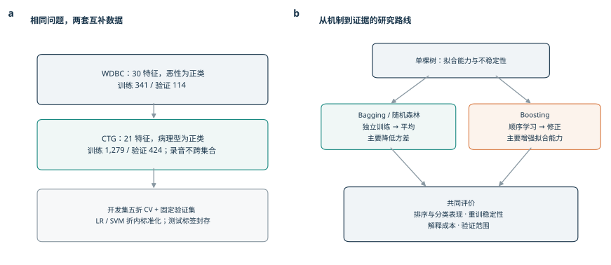

**图 1｜同一评价原则连接两套数据与两条集成路线。**a，固定开发数据与预处理协议；b，bagging／森林从独立训练与平均出发，boosting 从顺序修正出发。图为研究设计示意，不代表已经证明某个机制必然改善所有数据。数据：本课学生训练与验证文件。

### 2.2 【核心】为什么标准化必须在折内拟合

标准化常把一个变量减去训练均值，再除以训练标准差：

```math
z = (x − μ_train) / s_train
```

**公式注释。**`x` 为某个原始特征值；`μ_train`、`s_train` 只由本轮训练部分计算；验证部分沿用它们。先对完整开发集拟合标准化再交叉验证，会让验证信息提前进入训练流程。本次用 `Pipeline(StandardScaler, LR/SVM)` 保证折内处理。

树主要比较数值的大小顺序，厘米换成毫米时阈值随之缩放，可实现的切分通常不变，所以一般无需为统一量纲而标准化。RBF-SVM 依赖距离；带正则化的 LR 也受尺度与优化影响，本课对二者规范地进行标准化。

### 2.3 本次评价与重复实验的固定设置

| 项目 | 实际设置 |
|---|---|
| 随机种子 | 1010 |
| 软件 | Python {{PYTHON}}；scikit-learn {{SKLEARN}} |
| 主比较模型 | 单树深度 4；bagging 100 棵全特征深树；RF 100 棵、节点候选 `sqrt`；AdaBoost 50 轮；GB 100 轮；标准化 LR／RBF-SVM |
| 比较指标 | ROC-AUC、AP、balanced accuracy、敏感度、特异度与混淆矩阵 |
| 稳定性 | 30 份共享训练重抽样；固定验证样本；算法种子不变 |
| 提升曲线 | 学习率 0.03／0.1／0.3，各观察至 500 轮 |
| 重要性 | 独立拟合 300 棵森林；验证置换 20 次，评分为 ROC-AUC |
| 测试使用 | 未读取教师目录或锁定测试标签；没有最终测试成绩 |

CV 表示“在开发数据不同折上的表现”，不等于外部验证。折间 SD 用来描述波动，不能直接当作置信区间或显著性检验。大量尝试后选到的最佳开发结果也会带有选择影响，因此本文把探索曲线与固定主比较分开解释。

> **课堂讲解 02｜协议。**“如果同一录音的相似片段同时出现在练习和考试中，成绩就可能偏高。CTG 的分组不是额外装饰，而是在明确我们要评价模型面对未见过录音时的能力。”

## 3. 重点一：读懂一棵树，才能理解集成要解决的问题

### 3.1 【核心】从根节点走到叶节点

决策树是一连串“某个特征是否小于等于阈值”的问题。根节点是第一道问题，内部节点继续提问，叶节点是终点。训练时确定特征和阈值；预测时沿已有路径走到叶节点。

工作单 A 指定样本：`worst perimeter=120`、`mean concave points=0.08`。本次重新拟合深度 2 的 WDBC 树，得到与课件一致的路径：120 大于根节点阈值约 105.95，走右支；0.08 大于下一阈值约 0.05，再走右支；到达良性 3、恶性 112 的叶节点。

```math
P̂(恶性 | 叶节点) = 112 / (3 + 112) ≈ 0.974
```

**公式注释。**分子是该叶节点恶性训练记录数，分母是该叶节点全部训练记录数；`P̂` 表示估计概率。默认按 0.5 阈值分类时预测恶性。它是训练叶节点的经验比例，不是患者未来患病风险的临床证明。若训练带有样本权重，则使用加权类别比例。

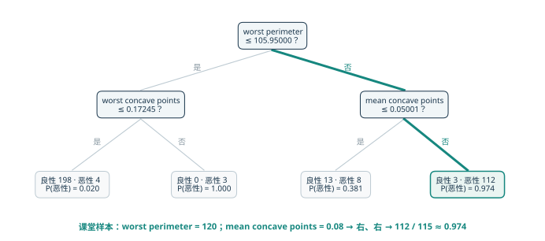

**图 2｜把模型预测还原成可检查的规则。**青绿色线标出课堂样本路径；节点显示本次拟合的阈值，叶节点给出训练类别计数和概率。课件阈值采用简写，实际程序使用保存的完整精度；本题远离边界，不影响结论。

### 3.2 【核心】怎样选切分：Gini 不纯度

“纯”表示节点里几乎全是同一类；“不纯”表示类别混杂。树在每个节点寻找使子节点加权不纯度下降较多的特征和阈值。

```math
Gini = 1 − (p₀² + p₁²)
ΔG = G_parent − [(n_L/n)G_L + (n_R/n)G_R]
```

**公式注释。**`p₀、p₁` 是该节点两类比例，和为 1；Gini=0 表示纯节点，二分类时最大为 0.5。`n` 是父节点样本数，`n_L、n_R` 是左右子节点数；`G_L、G_R` 是子节点不纯度；`ΔG` 是切分带来的下降。乘样本比例是为了兼顾左右节点大小。

例如 10 个样本中 8 良性、2 恶性，Gini 为 `1−0.8²−0.2²=0.32`。若切为“6 个全良性”和“2 良性＋2 恶性”，加权后为 `0.6×0+0.4×0.5=0.20`，下降 0.12。这里的 0.32 是混杂程度，不是错误率。树是逐节点贪心选择，不保证整棵树达到全局最优。

### 3.3 【实践 A】改变深度，观察训练与验证是否同步

按照工作单，把最大深度设为 1、2、3、4、不限。每次只改深度，保持训练与验证记录一致，同时记录两边准确率。

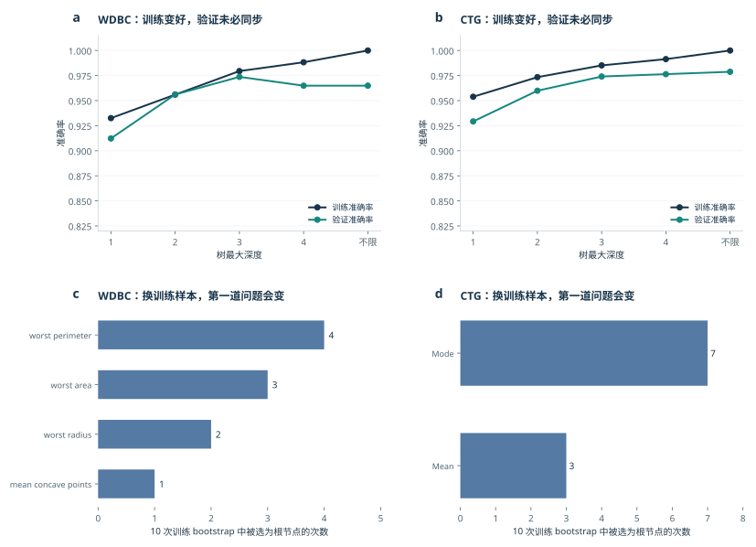

**图 3｜把“过拟合”和“对训练样本敏感”分成两项可观察证据。**a–b，同一划分上的训练／验证准确率曲线；c–d，对训练行做 10 次 bootstrap，每次拟合深度 2 的树，统计根节点特征。根节点频次反映这 10 次扰动，不是变量因果重要性。

**结果与解释。**WDBC 训练准确率由深度 1 的 0.933 升至不限深度的 1.000，验证准确率在深度 3 为 0.974，随后为约 0.965。深树记住训练数据，未带来同步的验证收益，符合过拟合的典型现象。CTG 在本次固定划分中，验证准确率随这些深度继续改善至约 0.979，不能硬套“所有数据在深度 3 最好”。其类别不平衡，还要进一步看 balanced accuracy 与敏感度。

10 次重抽样中，WDBC 根节点分别使用周长 4 次、面积 3 次、半径 2 次、平均凹点 1 次；CTG 在 `Mode` 7 次和 `Mean` 3 次之间变化。即使输入变量和算法都不变，训练样本变动也可能改写树最上层的规则。

### 3.4 【核心】低偏差、高方差究竟指什么

**偏差**指模型假设或拟合能力带来的系统性偏离；**方差**指换一批训练样本后预测变化多大。充分生长的树往往能拟合复杂关系，偏差较低，却可能对样本扰动敏感、方差较高。过浅的树则可能规则过粗，出现欠拟合。

“方差高”不是说原始特征取值分散，也不是说某次模型错误率高。它指重复训练之间的预测波动。因此观察一次验证成绩还不够，后面要把同一批验证样本拿给多次重训模型预测。

> **课堂讲解 03｜承上启下。**“树的问题不只是某一次错了多少，而是训练数据稍变，它的规则可能就变了。接下来我们不急着让一棵树更复杂，而是问：能否组合多棵不完全相同的树，让个别树的波动互相抵消？”

## 4. 重点二：硬投票、软投票与平均降低方差

### 4.1 【核心】硬投票数类别，软投票平均概率

硬投票先取各模型类别，再按多数决定；软投票先平均正类概率，再用约定阈值分类。

```math
P̄(x) = [P₁(x) + P₂(x) + … + P_B(x)] / B
P̄_weighted(x) = Σ_b w_b P_b(x) / Σ_b w_b
```

**公式注释。**`x` 是同一个待预测样本，`B` 是模型数，`P_b(x)` 是第 b 个模型的正类概率；`w_b` 是非负权重，权重和大于 0。第一式等权，第二式加权。阈值和权重如果需要选择，只能使用开发数据。不同模型的原始决策分数不能未经处理就当概率平均。

**实践 B 的完整手算：**

| 样本 | 真值 | 三模型类别 | 硬投票 | 平均正类概率 | 软投票（阈值 0.5） |
|---|---:|---|---|---:|---|
| A | 1 | 1、1、0 | 1，正确 | 0.650 | 1，正确 |
| B | 0 | 0、1、1 | 1，错误 | 0.483 | 0，正确 |
| C | 1 | 0、1、1 | 1，正确 | 0.633 | 1，正确 |
| D | 0 | 0、0、1 | 0，正确 | 0.367 | 0，正确 |

样本 B 中，两个模型只以 0.60、0.65 倾向正类，而另一个模型给出 0.20。平均后低于 0.5，于是软投票判为 0。这个例子说明软投票保留了倾向程度，**不说明软投票永远更好**；它仍依赖概率估计的质量。本课 sklearn 森林采用先平均树的类别概率、再选类别的方式。

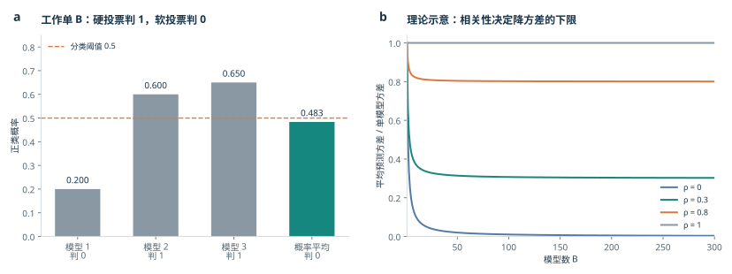

**图 4｜聚合规则与收益条件。**a，工作单样本 B 的概率与平均结果；b，在等方差、等两两相关假设下，不同相关性对应的理论方差曲线。b 为公式示意，不是从本次预测估计出的相关系数。

### 4.2 【核心中的核心】不是树越多越好，而是波动能否被平均

```math
Var(平均预测) = ρσ² + (1 − ρ)σ² / B
```

**公式注释。**`Var` 为方差；`σ²` 是单模型预测方差；`B` 是模型数量；`ρ` 是不同模型预测波动的两两相关性。此简化式假设模型方差相同、各对相关性相同，针对同一个预测位置在重复训练随机性下讨论，不是把准确率直接代入的公式。

必须能解释三点：

1. B 增大时，只缩小第二项，曲线趋向 `ρσ²`，边际收益递减。
2. 若 ρ 接近 1，树的波动几乎同步，增加数量也很难抵消。
3. 要继续降方差，除了增加树，还要降低树之间的相关性；随机森林的特征随机化正服务于这一目标。

课堂可用“错误是否同步”作直观解释，但严格说，公式中的 ρ 是预测随机变量的相关性，不等于两棵树各自错误率的相关性。本报告没有直接估计或声称验证了某个具体 ρ 数值。

平均也不能自动消除共同偏差：若所有模型都系统性高估某类样本，平均仍可能高估。因此 bagging 常搭配有较强拟合能力但波动较大的深树；对本来已经稳定的正则化 LR 再 bagging，收益可能较有限。

> **课堂讲解 04｜记忆句。**“硬投票先分类再数票；软投票先平均概率再分类。集成不是凑人数，关键是各模型的波动不能完全同步。”

## 5. 重点三：Bootstrap 怎样制造训练差异，OOB 怎样评价

### 5.1 【核心】有放回抽样保留样本量，却改变样本组成

原训练集有 n 条记录，bootstrap 每次有放回抽 n 次。抽完仍有 n 行，但某些原记录重复，另一些没出现。

工作单实例：原索引 `[1,2,3,4,5]`，抽为 `[2,2,5,1,2]`。记录 2 重复 3 次；不同记录为 1、2、5，占 60%；3、4 为本轮袋外记录，占 40%。重复改变权重，没有创造新的观测信息。

```math
P(某记录袋外) = (1 − 1/n)ⁿ
E(不同原记录占比) = 1 − (1 − 1/n)ⁿ
```

**公式注释。**`n` 是原训练记录数，一次抽样共抽 n 次；`P` 表示概率，`E` 表示重复抽样下的期望。一次不被选中概率为 `1−1/n`，连续 n 次都未选中取 n 次方。期望是长期平均规律，不是每次固定比例。

### 5.2 【实践 C】1,000 次模拟检验“63.2%／36.8%”

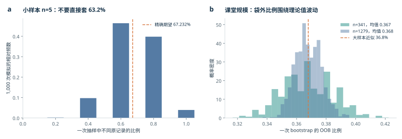

**图 5｜小样本精确值与大样本近似需要区分。**a，从 5 条抽 5 次，重复 1,000 次，不同记录占比是离散变量，精确期望为 67.232%；b，在课堂训练样本规模下，OOB 比例接近 36.8%，但每次仍波动。密度是分布形状，不代表有这么多条独立患者信息。

{{TABLE_BOOTSTRAP}}

**结果与解释。**只有 n 较大时，`(1−1/n)ⁿ` 才接近 `e⁻¹≈0.368`。n=5 的袋外期望是 **32.768%**，不能要求模拟得到 36.8%。这也是本课从“背数字”转向“知道数字适用条件”的典型例子。

### 5.3 【核心】Bagging：不同训练表，独立训练，最后聚合

Bagging 的步骤是：生成多份 bootstrap 训练表，每份训练一个模型，再平均预测或投票。第 20 棵树不需要知道第 19 棵树错了什么，所以可以并行训练。训练任务互不依赖，不表示树的预测在统计上完全独立，因为它们的训练记录可能重叠。

### 5.4 【核心】OOB 预测必须只来自没见过该记录的树

对训练记录 i，找出所有没有抽到 i 的树，只聚合这些树对 i 的预测；对每条训练记录重复，再与标签比较得到总体 OOB 指标。不能用已经见过 i 的树来给它提供 OOB 预测；也不能把各树单独的 OOB 准确率平均，视为必然等价于集成 OOB 指标。

观察记录近似独立时，OOB 可作内部评价、辅助开发阶段调参，不能替代独立测试或外部验证。分类森林默认 `oob_score_` 是**准确率**，不是 AUC。CTG 按行 OOB 还有结构性局限：当前片段虽未被抽到，同录音其他片段仍可能进入训练。此时“没见过这行”并不等于“没见过这段录音”，所以应以分组验证为主。

> **课堂讲解 05｜OOB。**“袋外是针对某棵树、某条记录说的。评价这条记录时，只允许训练中没抽到它的树发言；但 CTG 还得追问：这些树有没有见过同一录音的其他片段？”

## 6. 重点四：随机森林是否比平均多棵树更进一步

### 6.1 【核心】样本随机化之外，再随机限制节点候选特征

普通全特征 bagging 的每个节点可以考虑所有特征；本课随机森林在每个节点随机抽部分特征作为候选，再从候选中寻找切分。`max_features="sqrt"` 在 WDBC 对应约 5 个候选，在 CTG 对应约 4 个候选。

这不是让整片森林固定使用同一小批特征，也不是预先把重要特征删除。目的是防止所有树都被同一个强特征支配，从而增加差异、尝试降低相关性。代价是单树可能变弱，因此不是越随机越好。

### 6.2 【核心】先读懂指标，再读结果

| 指标 | 它回答什么 | 容易误解的地方 |
|---|---|---|
| ROC-AUC | 真实正类的分数是否通常高于真实负类 | 衡量排序，不等于固定阈值正确率或概率校准 |
| AP | 用 precision–recall 汇总稀少正类的检出与误报折中 | 本报告使用 `average_precision`；不同于梯形法 PR 面积，受正类比例影响 |
| Sensitivity | 真实正类中找出了多少 | 与正类 recall 相同；不能被总体准确率替代 |
| Specificity | 真实负类中正确排除了多少 | 与敏感度需要一起看 |
| Balanced accuracy | 对正负两类等权后的分类表现 | 依赖分类阈值；不能从 AUC 高自动推出 |

```math
Sensitivity = TP / (TP + FN)
Specificity = TN / (TN + FP)
Balanced accuracy = (Sensitivity + Specificity) / 2
Precision = TP / (TP + FP)
```

**公式注释。**TP 是真实正类且预测正类；TN 是真实负类且预测负类；FP 为误报，FN 为漏报。敏感度的分母是真实正类数，precision 的分母是预测正类数。各公式要求对应分母非零；本次各评价折均具备两类。

CTG 全数据正类约 8.3%，全部猜负类也可有约 91.7% 总体准确率，却一个正类都找不出，此时 balanced accuracy 为 0.5。因此本课不按单个 accuracy 排名。

### 6.3 【实践 D、F】集成改善单树，但是否超过简单基线

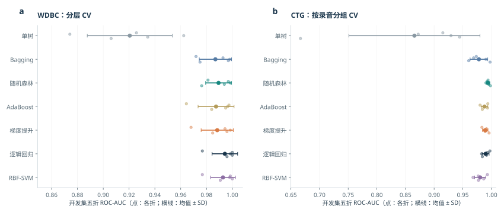

**图 6｜相同协议下的模型差异与折间波动。**a，WDBC 分层 CV；b，CTG 录音分组 CV。小点为各折 ROC-AUC，大点和横线为五折均值±样本 SD；横线不是 95% 置信区间。各方法使用相同折，软件与参数见方法部分。

**表 1a｜WDBC：固定验证与开发集 CV。**

{{TABLE_W_MAIN}}

**表 1b｜CTG：固定验证与开发集分组 CV。**

{{TABLE_C_MAIN}}

**结果一：WDBC 不支持“越复杂越好”。**单树 CV AUC 为 0.921±0.033，bagging 为 0.987±0.012，森林为 0.989±0.010，说明树集成明显改善单树。但 LR 为 0.994±0.010，SVM 为 0.993±0.010，复杂树集成并未提供超越这些基线的证据。固定验证集上 LR／SVM AUC=1，也仅意味着这 114 条记录的排序很好，不保证未来完美。

**结果二：CTG 体现森林的额外价值，但指标不能混读。**按录音分组 CV，RF 的 AP=0.944，LR=0.923；balanced accuracy 分别约 0.925、0.872，支持把 RF 保留为有力候选。GB 的 CV balanced accuracy 约 0.928，略高于 RF，但 AUC、AP 略低于 RF。因此“最好”取决于优先目标。

**结果三：同一验证集也能出现 AUC 高、默认阈值表现反而低。**CTG 的 RF 验证 AUC=0.996，高于 LR 的 0.994；但 RF 的 TP=27、FN=7、FP=1、TN=389，balanced accuracy≈0.896。LR 的 TP=29、FN=5、FP=4、TN=386，balanced accuracy≈0.921。LR 多找出 2 个正类，同时多了 3 个误报；AUC 与阈值分类关注的不是同一个问题。本文没有根据这些结果事后调整测试阈值。

**怎样比较差距与波动？**WDBC 的 RF 与 LR CV AUC 均值相差约 0.0049，小于各自约 0.010 的折间 SD；CTG 均值差约 0.0042，也要和 RF 的 SD≈0.0029、LR 的 SD≈0.0061 一起看。差距与波动的比较用于提醒谨慎，不能用“均值差大于一个 SD”直接宣布显著；相同折的结果还存在配对关系，正式推断需另设分析。

### 6.4 【实践 D、G】表现之外，平均是否真的更稳定

对训练集抽取 30 份有放回样本，每种方法使用同一轮索引，各次模型种子固定；验证集始终不变。记录每个验证样本的重复预测概率，再计算 SD 与类别翻转。

```math
P̄_i = (1/R)Σ_r P_(r,i)
SD_i = √[(1/R)Σ_r(P_(r,i) − P̄_i)²]
翻转率 = 重训中曾同时被判为 0 和 1 的验证样本数 / 验证样本总数
```

**公式注释。**`R=30` 为重训次数；`P_(r,i)` 是第 r 次模型对同一个验证样本 i 的正类概率；SD 使用分母 R，与 NumPy `ddof=0` 一致。表中平均 SD 再对验证样本取平均。翻转按 `P≥0.5` 判正，统计“是否曾出现两类”，不是相邻训练间切换次数，也不是真实错误率。

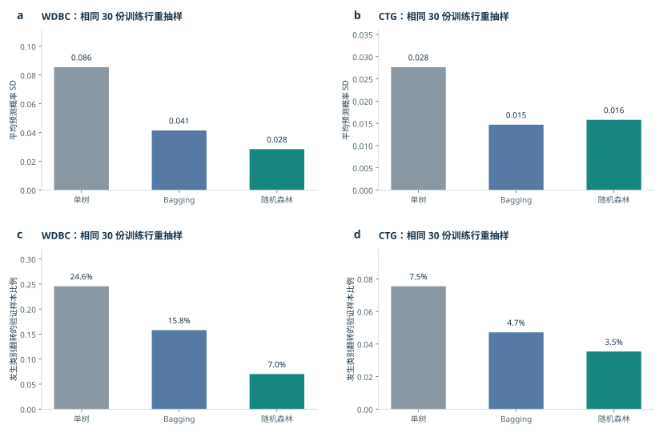

**图 7｜概率波动与类别翻转描述不同侧面。**a–b，验证样本平均预测 SD；c–d，出现过类别翻转的样本比例。主图均按训练行 bootstrap，以对齐课堂演示；CTG 的整录音抽样见图 11。没有重新随机划分验证集。

{{TABLE_STABILITY}}

WDBC 的平均 SD 从 0.0855 降至 RF 的 0.0284，翻转率由 24.6% 降至 7.0%，符合平均降低训练扰动波动的机制。CTG 的 bagging 平均 SD（0.0147）略低于 RF（0.0158），RF 翻转率却更低（3.5% 对 4.7%）。这不矛盾：概率波动幅度和是否跨过 0.5 边界是不同量。稳定也不等于正确，一个始终给错答案的模型同样可能很稳定。

### 6.5 【实践 D】增加树数的收益何时进入平台

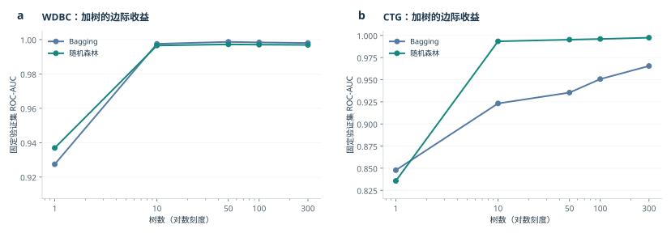

**图 8｜树多通常使平均更充分，收益因数据与机制而异。**固定训练／验证划分、种子与其余配置，比较 1、10、50、100、300 棵。曲线为本验证集表现，有限样本上不保证单调。横轴用对数刻度以同时显示小树数与大树数区间。

WDBC 在较少树数后已接近平台；CTG 森林较快达到较高 AUC，而全特征 bagging 改善较慢。为减少两个类实现差异的干扰，本次还使用同一个 `RandomForestClassifier`，仅改变 `max_features`：CTG 验证 AUC 从全特征的 **0.951** 变为 `sqrt` 的 **0.996**，WDBC 则从 **0.998** 到 **0.997**。结果支持特征随机化在 CTG 更有收益；它并非每个数据集都获益。

“树数更多通常不因数量本身导致典型过拟合”不等于“森林永远不会过拟合”。深度、叶节点大小、数据泄漏和环境变化仍可能造成问题；数量增加还会增加计算、内存和预测成本。图中的性能变化也只是与相关性机制一致，不能当成直接测得 ρ 下降的证据。

### 6.6 【核心】调参数时，先说清希望改变哪种行为

| 参数 | 直观作用 | 实验时应该看什么 |
|---|---|---|
| `max_depth` | 限制每棵树的规则深度 | 训练改善是否伴随验证改善 |
| `min_samples_leaf` | 要求叶节点至少保留若干训练样本；调大通常更平滑 | 是否降低波动，又是否遗漏有用细节 |
| `max_features` | RF 每个节点允许尝试多少候选特征 | 单树强度与树间差异的折中 |
| `n_estimators` | 模型数／阶段数 | 森林看平台与成本，boosting 还看过拟合 |
| `learning_rate` | 每轮修正迈多大一步 | 与轮数联合观察验证损失 |
| `subsample` | 经典 GB 每轮训练所用样本比例 | 小于 1 引入随机性，可能改变偏差与方差 |
| SVM 的 `C`、`gamma` | 分别影响正则化折中和 RBF 局部影响范围 | 必须标准化并用开发验证，不能盲目增大 |

同名参数也要看作用层级：`BaggingClassifier.max_features` 通常在每个基学习器层面抽特征，RF 的同名参数在节点层面限制候选。本课 bagging 设置为全部特征，避免把两层随机化混在一起。

> **课堂讲解 06｜读结果。**“先问集成有没有改善单树，再问它有没有超过简单基线。WDBC 的答案和 CTG 不一样，这正说明我们需要实验，而不是背一个算法排名。”

## 7. 重点五：Boosting 用顺序修正代替独立平均

### 7.1 【核心】AdaBoost 改变样本权重

起初各记录权重相同；每轮拟合简单分类器后，提高本轮错分记录的相对权重，让下一轮更关注它们；最后对各轮模型加权组合。由于下一轮依赖当前权重，阶段之间有顺序关系。

本次从已拟合 AdaBoost 的前 3 个基学习器及其权重，按二分类离散更新重建样本权重变化，追踪“本轮错分记录合计拥有多少训练权重”：

{{TABLE_ADA}}

表中“更新后权重占比”针对**同一轮那一批错分记录**，不能读成下一轮模型必有 50% 错误率。它展示注意力分配，而不是说这些记录变成了更多独立样本。若难例实际是噪声或错误标签，反复提高关注可能追随噪声。

### 7.2 【核心】Gradient Boosting 学的是损失的负梯度

“损失”给预测偏离标签的程度打分；“梯度”描述局部变化方向；沿负梯度可以让损失下降。二分类梯度提升先产生原始分数 F，再通过 sigmoid 转成概率。

```math
P = 1 / [1 + exp(−F)]
Log-loss = −(1/n)Σ_i[y_i ln(P_i) + (1−y_i)ln(1−P_i)]
r_i = y_i − P_i
F_t(x) = F_(t−1)(x) + ηh_t(x)
```

**公式注释。**`F` 是按对数几率尺度理解的原始分数；`P` 为正类概率；`y_i` 是 0／1 真值；`ln` 为自然对数，`exp` 为指数函数，`Σ` 表示逐条相加；log-loss 越低越好。`r_i=y_i−P_i` 是对原始分数 F 求导得到的负梯度；`h_t` 为本轮拟合的修正函数，`η` 是学习率。最后一式是机制简写，实际实现可进一步更新叶值；不是直接无限往概率上累加。

| 真值 | 当前概率 | y−P | 本轮应修正的方向 |
|---:|---:|---:|---|
| 1 | 0.20 | +0.80 | 明显提高正类倾向 |
| 1 | 0.90 | +0.10 | 已分对仍可小幅修正 |
| 0 | 0.80 | −0.80 | 明显降低正类倾向 |
| 0 | 0.10 | −0.10 | 已分对仍有修正方向 |

因此 GB 不是只训练错分记录。因为修正目标是可正可负的连续值，它的基学习器用回归树拟合；整体模型最终仍完成分类。

### 7.3 【实践 E】同时观察学习率、轮数、训练与验证损失

将学习率设为 0.03、0.1、0.3，各拟合至 500 轮，再用阶段预测观察整条曲线。所有阶段仍只用 train 拟合，固定 validation 用于观察，测试保持封存。

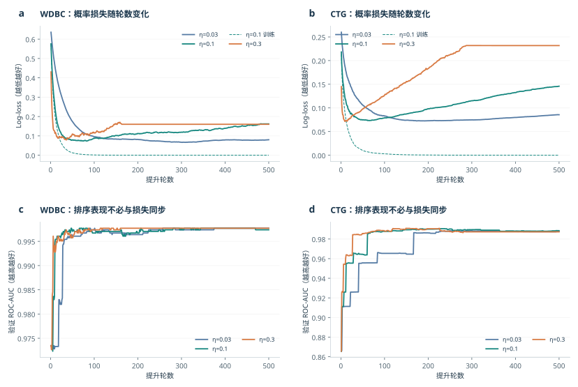

**图 9｜训练损失继续下降，验证概率质量可能恶化。**上排为验证 log-loss，另以虚线显示学习率 0.1 的训练 log-loss；下排为同阶段验证 AUC。不同学习率具有不同学习路径，乘积相同不代表模型相同。曲线是开发阶段探索，不是新的独立测试。

{{TABLE_BOOSTING}}

**WDBC 的具体观察：**学习率 0.1 时，50 轮验证 log-loss 约 0.079，500 轮为 0.162，训练损失却进一步趋近零；两处 AUC 都约 0.997。CTG 也出现验证损失在较少轮数较低、继续训练后升高的现象。

**为什么 AUC 几乎不变？**AUC 只关心正负样本排序；log-loss 还关心概率有多自信。实际为 0 的记录，预测从 0.8 变到 0.99，可能没有改变排序，却变成更自信的错误。实际为 1 时，预测概率 0.9 的单样本损失约 0.105，预测 0.01 则约 4.605。

这组实验不能粗略总结为“GB 最佳 50 轮”。在逐轮观察中，学习率 0.1 的最小验证 log-loss 出现在 WDBC **83 轮**、CTG **66 轮**；这些是本开发验证数据上选出的探索性位置，不具备独立评价资格，也不应再拿同一验证最小值当无偏泛化成绩。

学习率较小通常需要更多轮；应使用合适的开发验证或早停控制轮数。CTG 的早停验证也必须按录音隔离，不能不加检查地使用按行随机内部划分。

### 7.4 【了解拓展】XGBoost、LightGBM 与 sklearn 的关系

它们都属于梯度提升树家族。XGBoost 引入明确的树复杂度惩罚，利用一阶和二阶信息，并提供高效计算、缺失值处理等功能；LightGBM 常用直方图与按叶生长策略，也提供二阶信息和复杂度控制。二阶信息可理解为在下降方向之外利用损失局部弯曲程度。

sklearn 的经典 `GradientBoostingClassifier` 适合讲解逐轮修正；`HistGradientBoostingClassifier` 是使用直方图分箱的另一实现，其缺失值处理等能力与经典实现不同。库之间的参数名和默认值不能直接照搬。课堂只要求理解关系，不要求安装运行这些库。

> **课堂讲解 07｜区别。**“Bagging 让多棵树各自学习，再平均；AdaBoost 改变下一轮关注谁；梯度提升则告诉下一棵树应该往哪个方向修正。Boosting 的后一步依赖前一步，所以轮数不能只按‘越多越稳’解释。”

## 8. 重点六：特征重要性解释预测依赖，不能直接解释因果

### 8.1 【核心】两种重要性不是同一把尺子

**不纯度重要性**汇总某特征在树切分中带来的加权不纯度下降，并归一化、跨树汇总；计算快，但可能偏向可选切分多的变量，相关特征也可能竞争或分摊贡献。

**置换重要性**固定模型，在验证集中打乱一个变量的行顺序，再看指标变差多少。它更接近问“这个已拟合模型在预测时有多依赖该变量”。

```math
I_j = AUC_original − AUC_permuted,j
```

**公式注释。**`I_j` 是第 j 个特征的置换重要性；先固定模型与验证数据，除被打乱变量外其余内容不变。本次重复 20 次，报告平均 AUC 降幅与置换 SD。重要性接近零可由替补、未使用或有限样本造成；负值也不自动证明删除该变量有益。

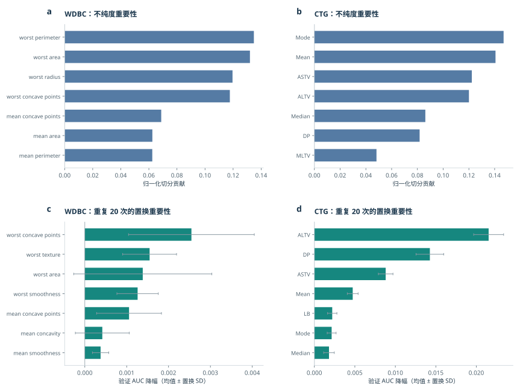

**图 10｜同一个预测任务，不同重要性定义会产生不同排名。**独立拟合 300 棵森林后计算；上排为不纯度重要性前 7 名，下排为验证 AUC 置换降幅前 7 名。下排误差线为 20 次置换的 SD，不是患者风险区间，也不是跨重训的 SD。

### 8.2 【实践 D】先看相关矩阵，再解释不一致

WDBC 中 `worst perimeter`、`worst area`、`worst radius` 的不纯度重要性约为 **0.135、0.132、0.120**，但单独置换时 AUC 平均下降仅约 **0.00020、0.00138、0.00007**。这些变量都在表达大小信息，模型可能依靠其余变量作替补，不能据此说“肿块大小完全没用”。训练相关矩阵与补充图 S1 给出了核查线索。

CTG 的不纯度排名以 `Mode`、`Mean`、`ASTV`、`ALTV` 等靠前，置换排名则以 `ALTV`、`DP`、`ASTV` 靠前。本次它们的 AUC 平均下降分别约 **0.0215、0.0143、0.0088**。排名变化符合“训练切分贡献”和“预测时能否被替补”问法不同的特点。

相关性可解释部分冗余，但不能单凭相关矩阵证明替补机制的全部细节。置换还可能制造不常见的变量组合，因此也要带着数据结构解释。重要性只描述本模型在本评价数据下的预测依赖；**ALTV 重要不等于 ALTV 的变化造成病理型**。

> **课堂讲解 08｜避免因果误读。**“重要性排名高，说明模型在某种定义下依赖它。要判断改变这个变量会不会改变疾病，需要额外的因果研究；一张重要性图回答不了这个问题。”

## 9. 重点七：稳定性、指标区间与外部泛化是三个问题

### 9.1 【核心】先问重抽样的对象是什么

| 研究问题 | 重抽样时改变什么 | 是否重新训练 | 可以解释到哪里 |
|---|---|---|---|
| 训练扰动稳定性 | 训练记录或训练录音 | 是 | 模型对该抽样机制的敏感性 |
| 固定模型指标波动 | 评价记录或评价录音索引 | 否 | 条件于当前已拟合模型的评价抽样波动 |
| 外部人群泛化 | 医院、时期、设备、目标人群等 | 需要独立研究设计 | 内部重抽样本身不能证明 |

第 6 节的预测 SD 是第一类，不能当作个人风险置信区间或测试 AUC 区间。算法种子变化又是另一种随机性；本次主要固定种子，避免把两种来源混在一起。

### 9.2 【实践 G＋补充核查】CTG 的“行”不是独立录音

主稳定性实验按训练行重抽样，以对齐课堂脚本；补充实验则从 209 个训练录音中有放回抽 209 个录音，每次把所选录音的所有片段纳入训练。同一录音重复被抽到时，其片段整体重复，因此每次训练片段数可以变化。验证录音始终固定且与训练不重叠。

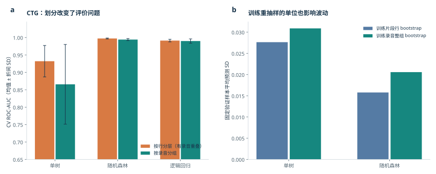

**图 11｜CTG 的两项补充诊断。**a，对相同开发数据使用按行分层 CV 与按录音分组 CV；前者各折有大量录音跨训练／验证。两种划分的训练构成也不同，分数差不能全部归因为某个单一因素。b，固定验证样本下，对比训练行与训练录音 bootstrap 的平均预测 SD。主流程仍以分组 CV 为准。

**观察一：忽略录音结构会改变评价结果。**按行 CV 中，每折有 **154–167** 个录音同时出现在训练与验证。单树平均 AUC 为 **0.932**，按录音分组时为 **0.866**；RF 分别约 **0.997** 与 **0.994**。这些数字说明本数据中划分方式具有实质影响，不能把按行高分当成面对未见录音的相同证据。

**观察二：抽样单位改变了预测波动。**CTG 的 RF 平均预测 SD 从行抽样的 **0.0158** 变为整录音抽样的 **0.0206**；单树从 **0.0276** 到 **0.0309**，bagging 从 **0.0147** 到 **0.0212**。翻转率未必同方向变化，进一步说明“波动大小”和“是否跨阈值”不是同义词。这是与组结构有关的敏感性核查，不能冒充已经完成新医院验证。

### 9.3 【了解拓展】固定模型后，还可以研究指标的条件区间

为明确第二类问题，本次固定 RF 与 LR 的验证预测，做 1,000 次配对重抽样：WDBC 抽验证行，CTG 抽验证录音并保留其全部片段；两个模型每次使用相同索引，不重新拟合。每次计算 `AUC_RF−AUC_LR`，取第 2.5、97.5 百分位。

{{TABLE_CONDITIONAL}}

这只是**当前固定验证集与已拟合模型条件下的探索性百分位区间**，没有包含重新训练、开发阶段模型选择或跨医院变化，也没有作完整选择后推断。CTG 区间跨 0，提示固定验证集上很小的 AUC 差应谨慎解释；WDBC RF 未胜过 LR。不能由此单独给出正式临床优效性结论。

> **课堂讲解 09｜三个问句。**“换训练样本，答案会不会变？固定模型换评价样本，分数会不会变？换一家医院，还能不能用？这三件事改变的对象不同，本课不能用一个 bootstrap 把它们全部回答。”

## 10. 综合判断：用四项证据作有条件的模型选择

### 10.1 【核心】表现、稳定性、解释成本、验证范围缺一不可

| 维度 | WDBC 的证据与含义 | CTG 的证据与含义 |
|---|---|---|
| 表现 | 树集成改善单树，但 LR／SVM 已很好 | RF 的分组 CV AUC、AP 较强，GB 的 CV BA 也值得保留；固定验证阈值下 LR 有优势 |
| 训练稳定性 | RF 比单树明显稳定 | 组抽样仍显示集成较单树低波动；抽样层级影响具体数值 |
| 解释成本 | 若系数解释和简洁性重要，可优先保留 LR | 森林／GB 更难直接解释，需要结合验证与重要性限制 |
| 验证范围 | 仅本数据与开发协议，未核验患者独立性 | 按录音隔离，但录音不一定等于孕妇；没有外部人群 |
| 当前建议 | LR 可作首选候选，SVM 作性能对照；无充分理由只因“集成”更复杂而替换 | 保留 RF／GB，与 LR 对照；先明确优先指标，再在开发阶段定阈值和轮数 |
| 会改变建议的证据 | 新独立数据上复杂模型有可重复且有实际意义的改善 | 外部录音中森林检出不足、校准失效或收益消失，或 GB 更稳定获益 |

注意：本次 30 次稳定性重训只覆盖单树、bagging、RF。**没有对 LR、SVM、GB 做同样稳定性比较，不能宣称它们已被证明比 RF 更稳定或更不稳定。**系数可解释也不自动带来因果解释。

### 10.2 【必做 H】Bagging 与 Boosting 的机制对照

| 方面 | Bagging／随机森林 | Boosting |
|---|---|---|
| 训练关系 | 各基模型可独立训练、并行 | 阶段顺序依赖；可并行单棵树内部计算，不改变阶段关系 |
| 每轮数据或目标 | 每棵树一份 bootstrap；森林另限制节点候选特征 | AdaBoost 改样本权重；GB 拟合负梯度；部分实现另有采样 |
| 基学习器 | 常用低偏差、高方差的较深树 | 常用树桩或浅树，依任务和实现调整 |
| 聚合 | 平均预测／概率或类别投票 | 加权组合或阶段修正累加 |
| 主要收益方向 | 平均降低方差 | 逐轮增强拟合能力，主要降低偏差，同时需控制方差 |
| 噪声和轮数 | 平均通常较稳健，树数增加常趋平台 | 可能持续追随噪声，轮数过多可使验证变差 |
| 关键参数 | 树数、候选特征数、叶节点大小、深度 | 学习率、轮数、深度／叶数、采样与正则化 |

“深树用来平均，浅树用来逐步增强”是便于理解的典型配置，不是不能打破的算法定义。也不要把所有集成基模型都叫弱分类器；森林的单棵深树可把训练集拟合得非常好。

### 10.3 【课堂可展示】WDBC 研究备忘录示例

> 本研究在 WDBC 开发数据上比较七类分类方法，沿用固定训练与验证划分，并采用分层五折交叉验证，测试标签未参与选择。单树 CV AUC 为 0.921，随机森林为 0.989，说明集成改善了单树；但逻辑回归达到 0.994，复杂模型未显示超过简单基线的优势。共享训练重抽样中，森林类别翻转率为 7.0%，低于单树的 24.6%，支持其对本次样本扰动更稳定。考虑到逻辑回归的简洁性与系数解释需求，我优先保留它，并以 SVM 和森林作对照；尚不能声称逻辑回归的重训稳定性已获验证。结论只限于本数据、标签与协议，不代表未来患病风险或跨医院效用。若独立数据表明集成具有可重复且有实际意义的性能或校准优势，我会重新评估选择。

### 10.4 【课堂可展示】CTG 研究备忘录示例

> 本研究对 CTG 片段的病理型标签进行分类，训练、验证和交叉验证均按录音隔离。随机森林分组 CV AUC 为 0.994、AP 为 0.944，高于逻辑回归的 0.990 和 0.923；梯度提升的 CV 平衡准确率也值得关注。不过固定验证集中，逻辑回归在默认阈值下找出更多正类，说明排序优势不能替代阈值检出表现。共享重抽样显示树集成较单树稳定，整录音抽样下森林平均预测 SD 为 0.0206。结合森林较高的解释成本，我保留森林与梯度提升，同时保留逻辑回归作为对照，再按预定目标选择阈值和轮数。结论仅适用于本数据与录音分组协议，既不能证明因果，也不保证适用于新医院。若外部录音中其敏感度或概率校准明显下降，或相对基线的收益消失，我会改变当前建议。

两段示例都使用本次开发实验结果，目的在于示范证据组织。实际提交时应注明自己的数据选择、软件环境和运行结果，不把演示报告冒充个人独立完成的全部实验。

## 11. 方法与可复现材料

### 11.1 数据输入与禁止泄漏的边界

本次只读取 `data/student/train.csv`、`validation.csv` 与 `data-ctg/student/train.csv`、`validation.csv`。标签均按课程编码使用，排除 `sample_id`、`recording_id` 与标签列；本报告构建流程没有打开 `teacher/` 或锁定测试文件。数据来源及历史性质依据项目数据说明 [1–2]。

输入文件、课堂课件、工作单和模型定义文件的 SHA-256、软件版本、随机种子与运行记录保存在 `results/manifest.json`。这支持核查“用了哪一份输入”，不等于数据独立性或外部适用性已经被证明。

### 11.2 模型、超参数与指标计算

单树深度 4；bagging 使用 100 棵不限深度决策树、全特征，训练 bootstrap；RF 使用 100 棵树、`max_features="sqrt"`；AdaBoost 50 轮；经典 GB 100 轮、默认学习率 0.1 和深度 3。LR 为标准化 pipeline、`max_iter=5000`；RBF-SVM 为标准化 pipeline、C=1，使用默认核尺度。完整设置沿用原演示脚本的 `models()`。

AUC 与 AP 使用连续得分；有 `decision_function` 时优先使用该分数，否则取正类概率。主比较的类别由模型 `predict()` 给出，未事后调阈值。AP 使用 sklearn `average_precision_score`，不与梯形积分 PR 面积混称。五折 SD 用 `ddof=1`；稳定性概率 SD 用 `ddof=0`，与课堂脚本一致。

### 11.3 主实验与补充实验的区分

| 类型 | 内容 | 目的 |
|---|---|---|
| 主实验 | 课件树、深度、10 次根节点重抽样、投票手算、1,000 次 bootstrap 模拟 | 对齐工作单 A–C |
| 主实验 | 七模型固定验证与共享 CV、30 次行 bootstrap、树数、GB 学习率轮数、两种重要性 | 对齐 D–G，并提供 H 的证据 |
| 补充核查 | 同一 RF 实现只改变 `max_features` | 减少实现差异对机制比较的干扰 |
| 补充核查 | CTG 按行 CV 与按录音 CV、30 次整录音训练 bootstrap | 检查数据依赖与抽样单位 |
| 了解拓展 | 固定验证预测的 1,000 次配对指标 bootstrap | 演示“指标区间”与“重训稳定性”不同 |

全部主结果为预设配置的开发评价；学习曲线的低点为探索性观察。没有用最终测试筛选方案，也未声称进行了临床优效性或因果推断。对于训练稳定性，CTG 的整录音 bootstrap 比行抽样更贴合录音依赖，但仍不是孕妇或医院层面的完整抽样设计。

### 11.4 如何重现与找到原始结果

报告目录保留 `scripts/run_experiments.py`、`make_figures.py`、`build_report.py`；按此顺序运行，可重新得到数表、图和文稿。报告驱动脚本调用原教学脚本的数据读取与模型定义，未调用其有父目录索引问题的 `main()`，因此原脚本无需改写。

`results/wdbc/` 与 `results/ctg/` 包含固定验证结果、每折指标、CV 汇总、树深度、根节点、树数曲线、逐轮 boosting 结果、AdaBoost 权重追踪、重要性与预测稳定性等文件。图均提供 SVG 矢量版与高分辨率 PNG；HTML 将主图内嵌，便于离线打开。

> **课堂讲解 10｜报告的边界。**“本次实验能说明这些机制在这份数据和协议下怎样表现，不能说明模型适用于所有医院。我们把限制写清楚，是为了让下一步研究知道还缺什么证据。”

## 12. 课堂展示路线与工作单交付核对

### 12.1 建议的 20 分钟讲解顺序

| 时间 | 讲解重点 | 建议展示 | 让听众带走的一句话 |
|---|---|---|---|
| 0–2 分钟 | 样本、标签与研究问题 | 图 1、数据定义 | 先明确模型预测什么，再比较高分 |
| 2–5 分钟 | 读树、Gini、深度与不稳定 | 图 2–3 | 训练全对不等于泛化好 |
| 5–8 分钟 | 软硬投票、方差、bootstrap 与 OOB | 图 4–5 | 不同步的波动才能被平均 |
| 8–12 分钟 | Bagging→森林、性能与稳定性 | 图 6–8 | 集成要同时和单树、简单基线比较 |
| 12–15 分钟 | Boosting 顺序修正、轮数与损失 | 图 9 | AUC 不变不表示概率质量不变 |
| 15–17 分钟 | 两种重要性及其限制 | 图 10 | 模型依赖不是因果作用 |
| 17–20 分钟 | 分组、不确定性与有条件选型 | 图 11、备忘录 | 表现、稳定性、解释成本和验证范围共同决定建议 |

讲解时每页先说一个问题，再指图上的一处证据，最后给出一条有限结论。首次展示可把固定模型指标区间与补充图留到问答，避免主线被统计细节打断。

### 12.2 A–H 的证据位置

| 工作单 | 已呈现的知识与实践 | 对应报告 |
|---|---|---|
| 数据与协议 | 观察单位、标签、ID、分组、训练／验证／测试 | 第 1–2、11 节 |
| A | 完整读树路径、概率、Gini、深度、根节点变化、标准化 | 第 2–3 节；图 2–3 |
| B | 四样本软硬投票、方差公式及收益下限 | 第 4 节；图 4 |
| C | 抽样重复与 OOB、1,000 次模拟、精确期望与近似、bagging 并行 | 第 5 节；图 5 |
| D | 三模型表现与稳定性、节点随机化、树数平台、重要性及相关性 | 第 6、8 节；图 6–8、10、S1 |
| E | Ada 权重、y−P、学习率与轮数、实现关系 | 第 7 节；图 9 |
| F | LR／SVM／RF／GB 的统一比较与选型 | 第 6、10 节；表 1a–b |
| G | 共享训练重抽样、SD／翻转率、指标区间、外部范围 | 第 6、9 节；图 7、11 |
| H | Bagging／boosting 对照与两套备忘录示例 | 第 10 节 |

### 12.3 展示前应能独立回答的六个追问

1. 叶节点 0.974 是怎样算来的？为什么不能直接称为未来风险？
2. ρ 接近 1 时，增加树数为什么可能收效很小？
3. n=5 的模拟为什么不是每次、也不是平均 36.8% OOB？
4. 为什么 CTG 的普通行 OOB 不能取代录音分组验证？
5. 为什么 RF 的 AUC 更高，LR 的默认阈值敏感度仍可能更高？
6. 如果下一份数据来自新医院，本报告哪一句结论需要重新验证？

## 补充图：相关特征如何影响重要性阅读

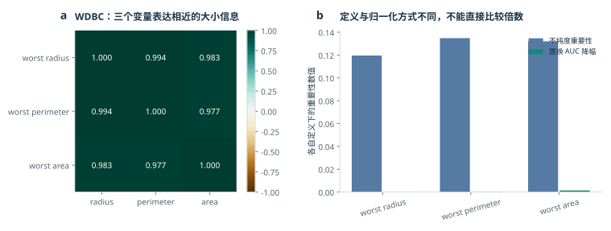

**补充图 S1｜同组预测信息可能被替补。**a，WDBC 训练集三个大小相关特征的 Pearson 相关矩阵；b，这些特征各自的不纯度重要性与置换 AUC 降幅。两种数值定义与归一化方式不同，不能比较倍数或相加；并列呈现是为了说明“训练切分贡献较明显”与“单独打乱时损失较小”可以同时出现。相关性并不证明因果，也不能独自证明替补的全部机制。

## 参考资料与课程依据

1. UCI Machine Learning Repository. *Breast Cancer Wisconsin (Diagnostic)*. DOI: 10.24432/C5DW2B. 本课本地说明：`data/README.md`。
2. Campos D, Bernardes J. *Cardiotocography* [Dataset]. UCI, 2000. DOI: 10.24432/C51S4N. 本课本地说明：`data-ctg/README.md`。
3. Breiman L. Bagging predictors. *Machine Learning*. 1996;24:123–140. DOI: 10.1007/BF00058655.
4. Breiman L. Random forests. *Machine Learning*. 2001;45:5–32. DOI: 10.1023/A:1010933404324.
5. Friedman JH. Greedy function approximation: A gradient boosting machine. *Annals of Statistics*. 2001;29:1189–1232. DOI: 10.1214/aos/1013203451.
6. scikit-learn. Ensemble methods. <https://scikit-learn.org/stable/modules/ensemble.html>
7. XGBoost. Introduction to boosted trees. <https://xgboost.readthedocs.io/en/stable/tutorials/model.html>
8. LightGBM. Features. <https://lightgbm.readthedocs.io/en/stable/Features.html>
9. 课程课件：`slides/ensemble-pbl.pptx`，第 1–19 页；课堂工作单：`student-worksheet.md`，A–H。
10. 本项目既有《课程重点知识清单》与 `scripts/demo_ensemble.py`。教师参考文件用于前期资料核对，本报告数值来自独立重新运行的学生开发数据。

**材料定位。**本文件是采用研究报告结构的课堂教学材料，包含可复现的开发实验与教学讲解，不是已经发表的期刊论文，也未完成临床验证。
