# 集成学习的抽样、聚合与顺序修正机制

基于 WDBC 与 CTG 课堂实践的受控实验报告

Sampling, aggregation and sequential correction in ensemble learning

摘要　集成学习的收益取决于基学习器的拟合能力、训练扰动及模型间依赖。本报告沿用课堂固定划分与工作单 A—H，比较单树、bagging、随机森林、AdaBoost、梯度提升及 LR／SVM 基线，并以共享重抽样检验预测稳定性。WDBC 中，单树与随机森林的开发集交叉验证 AUC 分别为 0.921、0.989，但 LR 达到 0.994；随机森林的类别翻转率由单树的 24.6% 降至 7.0%。CTG 按录音分组后，随机森林的 AUC、AP 分别为 0.994、0.944。梯度提升的训练损失持续下降时，验证概率损失仍可能上升。结果支持区分平均降方差与顺序修正两条机制，并将模型选择限定于当前数据、指标和验证协议。

关键词　决策树；bootstrap；bagging；随机森林；boosting；预测稳定性；分组验证

## 1　数据定义与课堂问题

本课考察单树为何对训练样本变化敏感、平均在何种条件下有效，以及特征随机化和顺序修正能否带来额外收益。全部模型在各自数据集内使用相同输入、划分和评价规则。[1–3]

WDBC 每行是一份乳腺肿块穿刺样本的细胞核图像特征，30 个连续变量预测既有良恶性标签；恶性编码为 1。记录并非“一颗细胞一行”。

### 1.1　观察单位与输入边界

CTG 每行是一段胎心监护信号，21 个特征预测专家判读；病理型为 1，正常与可疑合并为 0。同一录音可包含多个相关片段，不能视为独立孕妇。

`sample_id` 不作特征；CTG 的 `recording_id` 仅用于分组。标签描述既有分类，不直接表示未来患病风险。图 1 只显示两个变量，正式拟合仍使用全部规定特征。

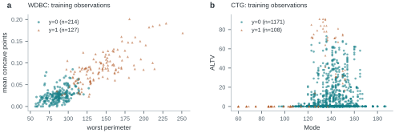

图 1｜两套训练数据的局部特征关系。a，WDBC 的较大细胞核周长汇总与平均凹点特征，341 条记录；b，CTG 的直方图众数与长时变异异常比例，1,279 个片段。全部记录参与显示与正式拟合；重叠点未人为抖动。二维分布只用于理解观测数据，不代表完整模型的决策边界。

表 1｜固定数据划分与集合职责

| 数据 | 训练（正类） | 验证（正类） | 测试记录数 | 开发 CV |
| --- | --- | --- | --- | --- |
| WDBC | 341（127） | 114（43） | 114 | 分层五折 |
| CTG | 1,279（108） | 424（34） | 423 | 录音分组五折 |

注：train 拟合模型及预处理；validation 用于配置对照；开发集为二者合并。测试在协议冻结后按教师安排评价，本报告未读取其标签。CTG 的 209 个训练录音与 73 个验证录音互不重叠。

## 2　节点切分与叶节点概率〔实践 A〕

### 2.1　以不纯度下降选择规则

决策树通过特征阈值把记录逐步分入不同区域。根节点给出第一条规则，内部节点继续切分，叶节点提供预测。对分类树，Gini 衡量节点内类别混杂程度。

式（1）中，pₖ 是节点内第 k 类比例；二分类纯节点 G=0，两类各半时 G=0.5。Gini 是类别分布的性质，不等同于该节点的错分率。

### 2.2　子节点大小进入切分评价

同一节点比较候选特征与阈值时，按左右子节点样本数加权不纯度，选择下降较大的切分。式（2）的 n、nᴸ、nᴿ 分别为父、左、右节点样本数。

若父节点 8 个负类、2 个正类，G=0.32；切为“6 个全负类”与“2 负、2 正”后，加权 G=0.20，下降 0.12。这是逐节点贪心准则，不保证全树全局最优。

> G(t)=1−Σₖpₖ(t)²　（1）
注：t 为当前节点，pₖ(t) 为节点内第 k 类的比例；本课 k=0、1，Σ 表示将两类对应项相加。

> ΔG=G(t)−(nᴸ/n)G(tᴸ)−(nᴿ/n)G(tᴿ)　（2）
注：ΔG 为切分前后的不纯度降幅；tᴸ、tᴿ 是左右子节点，nᴸ、nᴿ 是其记录数，n 为父节点记录数。

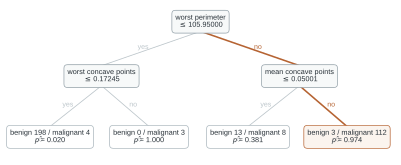

图 2｜WDBC 深度 2 分类树的实际拟合。阈值保留五位小数，叶节点给出训练类别计数及正类比例。赭色路径对应工作单样本：`worst perimeter=120`、`mean concave points=0.08`。节点值由原训练集重新拟合获得，未使用验证标签决定路径。

### 2.3　工作单样本的路径核对

120 大于根节点阈值约 105.95，进入右支；0.08 大于下一阈值约 0.05001，再进入右支。最终叶节点含良性 3 条、恶性 112 条，按 0.5 阈值判恶性。

课件阈值经过舍入，程序则使用完整精度。该样本远离边界，两种显示精度不改变本题结果。

### 2.4　概率是怎样得到的

式（3）的 N₁、N₀ 是该叶节点两类训练计数。这里估计值为 112／115≈0.973913；若采用样本权重，计数相应改为加权计数。

叶节点经验比例并非临床校准结论。尤其小叶节点出现 0 或 1，不表示未来记录的类别没有不确定性。

> p̂(y=1|L)=N₁/(N₀+N₁)　（3）
注：L 表示样本落入的叶节点；N₁、N₀ 分别为其中正、负类训练计数，p̂ 为由这些计数得到的概率估计。

## 3　树深度、训练拟合与样本扰动〔实践 A〕

### 3.1　固定划分下改变复杂度

最大深度限制根到叶最多经过多少次切分；深度 1 是树桩。分别取 1、2、3、4、不限，保持特征、记录与随机种子不变，同时计算训练和验证准确率。

WDBC 训练准确率由 0.933 升至 1.000，验证在深度 3 为 0.974，随后约为 0.965。继续拟合训练细节没有带来同步验证收益。

### 3.2　深度趋势并非通用结论

CTG 在所列深度中，验证准确率仍继续提高。因此不能把 WDBC 的深度 3 当成适用于所有数据的最优值。CTG 正类较少，总体准确率还需结合敏感度与平衡准确率阅读。

结构过简可能遗漏规律，称为欠拟合；结构过细可能学习偶然差异，称为过拟合。两者都应由保留记录上的表现检验。

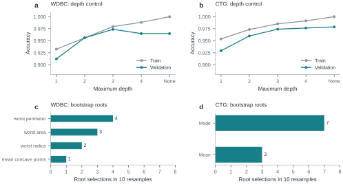

图 3｜深度与训练样本变化的两组对照。a、b，固定划分下改变最大深度；c、d，10 次有放回训练重抽样，各拟合深度 2 的树，统计根节点特征。重抽样保持算法种子不变；根节点频次不是变量的因果重要性。

表 2｜训练拟合与验证结果的深度对照

| 最大深度 | WDBC 训练准确率 | WDBC 验证准确率 | CTG 训练准确率 | CTG 验证准确率 |
| --- | --- | --- | --- | --- |
| 1 | 0.9326 | 0.9123 | 0.9539 | 0.9292 |
| 2 | 0.9560 | 0.9561 | 0.9734 | 0.9599 |
| 3 | 0.9795 | 0.9737 | 0.9851 | 0.9741 |
| 4 | 0.9883 | 0.9649 | 0.9914 | 0.9764 |
| 不限 | 1.0000 | 0.9649 | 1.0000 | 0.9788 |

### 3.3　偏差与方差所描述的对象

偏差指学习规则的系统性偏离，方差指更换训练数据后预测的变化。充分生长的树常能拟合复杂规律，但对样本组成敏感；这与原始特征自身的数值方差不同。

根节点改变后，下游可用数据和切分路径都随之改变，因此局部抽样差异可能传播到整棵树。

### 3.4　重抽样给出的直接证据

WDBC 根节点在周长、面积、半径、平均凹点之间变化，次数为 4、3、2、1；CTG 在 Mode 与 Mean 间变化，次数为 7、3。

这证明当前树结构对所施加的训练扰动敏感，尚不能仅凭根节点变化量化预测稳定性；后续需在共同验证记录上直接比较重复预测。

## 4　类别投票、概率聚合与平均预测方差〔实践 B〕

### 4.1　两种聚合规则

硬投票对模型给出的类别计数，按多数决定；软投票先平均各模型的正类概率，再分类。式（4）中 B 为模型数，pᵦ(x) 为第 b 个模型对同一样本 x 的正类概率。

若采用不同权重，可改为加权平均，权重应在开发数据内预定或选择。任意决策分数不能未经处理就解释为概率。

### 4.2　样本 B 的不同结论

工作单样本 B 真值为 0。三模型类别为 0、1、1，硬投票判 1；概率 0.20、0.60、0.65 的均值为 0.483，按 0.5 阈值软投票判 0。

概率聚合保留了倾向程度，但其质量依赖概率估计。此例不能证明软投票普遍更优。本课 sklearn 森林采用先平均树概率、再选择类别的实现。

> p̄(x)=(1/B)Σᵦpᵦ(x)　（4）
注：x 为待预测记录，B 为模型数量，pᵦ(x) 为第 b 个模型的正类概率；p̄(x) 为等权平均概率。

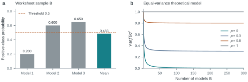

图 4｜工作单投票与平均方差机制。a，样本 B 的三模型概率和等权平均；b，等方差、等两两相关假设下的解析曲线。b 不是对本次模型相关系数的估计；各曲线的相关性预先指定，用于展示模型数量与相关性各自的作用。

表 3｜工作单四个样本的聚合核对

| 样本 | 真值 | 硬投票 | 平均正类概率 | 软投票 |
| --- | --- | --- | --- | --- |
| A | 1 | 1 | 0.650000 | 1 |
| B | 0 | 1 | 0.483333 | 0 |
| C | 1 | 1 | 0.633333 | 1 |
| D | 0 | 0 | 0.366667 | 0 |

> Var(f̄)=ρσ²+(1−ρ)σ²/B　（5）
注：σ² 为单模型预测方差，ρ 为模型预测波动的两两相关系数，B 为模型数量。讨论针对同一个预测位置的重复训练随机性；不能把准确率直接代入式（5）。

### 4.3　数量增加的收益为何递减

方差展开包含 B 个自身方差与 B(B−1) 个两两协方差。等方差、等相关时得到式（5）：增加 B 仅缩小第二项，极限为 ρσ²。

ρ=0 时方差为 σ²／B；ρ=1 时保持 σ²。课堂所说“错误同步”是直观类比，严格变量是预测波动的相关性。

### 4.4　平均不能消除共同偏离

若各模型都系统性高估同一类记录，平均仍可保留该偏离。bagging 因而常用于拟合能力较强、训练扰动较大的深树。

稳定的正则化 LR 也可作 bagging，但收益可能有限。组合多个模型有效与否，取决于可抵消的波动，而非仅取决于模型数量。

## 5　有放回抽样、袋外记录与 bagging〔实践 C〕

### 5.1　抽样量不变，记录组成改变

对 n 条原训练记录等概率、有放回抽 n 次，结果仍有 n 行，但包含重复和遗漏。索引 [1,2,3,4,5] 抽成 [2,2,5,1,2] 时，记录 2 出现三次，3、4 为本轮袋外记录。

本次不同记录占 3／5，袋外占 2／5；这不是每次固定比例。重复改变训练贡献，没有增加独立观测信息。

### 5.2　有限 n 的精确期望

某条记录一次未抽中概率为 1−1／n，连续 n 次都未抽中即式（6）。不同原记录比例的期望为其补集。

n 较大时袋外概率趋近 e⁻¹≈0.368；n=5 时精确值为 0.32768，不应强求模拟得到大样本近似。每组重复 1,000 次检验该关系。

> P_OOB=(1−1/n)ⁿ；E[U/n]=1−(1−1/n)ⁿ　（6）
注：P_OOB 表示一条原记录在本轮全部抽取中未出现的概率，也等于袋外比例的期望。期望表示重复抽样的平均规律，而非单次抽样的约束。

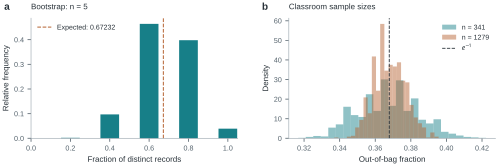

图 5｜抽样比例的实际模拟。a，n=5 时不同原记录比例是离散量，赭色虚线为精确期望 0.67232；b，WDBC、CTG 训练规模下的袋外比例分布，黑色虚线为大样本极限。每组均独立执行 1,000 次，随机种子为 1010。

表 4｜模拟均值与理论期望

| n | 不同记录比例均值 | 袋外比例均值 | 袋外比例精确期望 |
| --- | --- | --- | --- |
| 5 | 0.675000 | 0.325000 | 0.327680 |
| 341 | 0.632818 | 0.367182 | 0.367339 |
| 1279 | 0.632137 | 0.367863 | 0.367736 |

### 5.3　由抽样构造独立训练任务

Bagging 对每份 bootstrap 数据分别拟合基模型，再聚合预测。后一棵树不依赖前一棵树的预测，因此可并行训练；但训练数据彼此重叠，预测不一定统计独立。

本课全特征 bagging 在节点处允许考虑所有输入，先隔离样本重抽样与平均的作用。

### 5.4　OOB 以记录为单位汇总

对训练记录 i，只用训练时未抽到它的树聚合预测，再对全部记录计算 OOB 指标。已见过 i 的树不能参与该记录的 OOB 预测。

OOB 可提供内部评价，不能代替锁定测试。CTG 同录音其他片段可能仍在训练中，普通行级 OOB 不等于未见录音评价；默认 `oob_score_` 还是准确率而非 AUC。

## 6　节点特征随机化与树数对照〔实践 D〕

### 6.1　随机森林增加的随机性

本课森林同时使用训练样本 bootstrap 和节点候选特征抽取。每个节点先随机限制候选集合，再在集合内选择切分；并非整片森林始终固定使用同一小组特征。

`max_features="sqrt"` 在 30、21 个输入时分别对应约 5、4 个候选。强特征不再控制所有节点，可能降低树间相关性，但也可能削弱单树拟合能力。

### 6.2　受控比较与待解释量

单树设深度 4；bagging 与森林使用 100 棵可充分生长的树，这是课堂实用配置对照。为减少实现差异，另用同一个森林类，仅改变候选特征为全部或 sqrt。

两套数据在各自相同划分上比较，不合并估计。性能改善可与降相关机制一致，但不能视为已经直接测得 ρ 的变化。

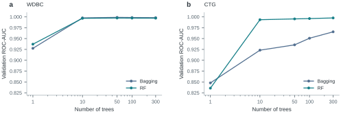

图 6｜树数增加的实际收益。a，WDBC；b，CTG。横轴为 1、10、50、100、300 棵的对数刻度，纵轴为固定验证 ROC-AUC。各配置重新拟合并保持种子及其余设置不变；曲线在有限验证样本上不要求单调。

表 5｜统一实现内改变节点候选特征

| 数据 | 全部候选：验证 AUC | sqrt 候选：验证 AUC | 差值（sqrt−全部） |
| --- | --- | --- | --- |
| WDBC | 0.998362 | 0.997052 | -0.001310 |
| CTG | 0.950867 | 0.996003 | +0.045136 |

### 6.3　数据结构影响随机化收益

CTG 的全特征森林验证 AUC 约为 0.951，sqrt 为 0.996；WDBC 则约为 0.998 与 0.997。额外随机化在两套数据上收益不同。

WDBC 的多个大小特征高度相关，更换候选仍可能提供近似信息。该解释需结合相关矩阵核对，不能仅由一次模型排名反推所有机制。

### 6.4　树数与树复杂度分别控制什么

增加树数通常使平均更充分、预测趋稳，不像 boosting 那样不断追踪前轮不足；但验证表现仍可能波动，森林也可能因过细叶节点或数据问题而过拟合。

`max_depth` 限制单树层数，`min_samples_leaf` 限制叶节点最少记录数；增大后者通常更平滑。树数增加另有时间、存储与推断代价。

注：`BaggingClassifier.max_features` 通常在基学习器层面抽特征，森林的同名参数在节点层面抽候选。本课 bagging 使用全部特征。CTG 的行级 OOB 高分不作为此处主比较依据。

## 7　共享训练重抽样与预测稳定性〔实践 G〕

### 7.1　改变训练数据，固定评价对象

使用同一批 30 份训练行 bootstrap，分别重训单树、bagging、森林；各方法共用本轮索引，模型随机种子不变。固定验证记录，保存每条记录的 30 个正类概率。

这样比较主要针对训练样本扰动，避免把不同抽样或新的验证划分混入方法差异。算法随机性若需研究，应另固定训练数据改变种子。

### 7.2　概率 SD 与类别翻转

式（7）的 pᵣᵢ 是第 r 次模型对同一验证样本 i 的概率，R=30；平均预测 SD 再对验证记录取均值。本次分母用 R，与课堂 NumPy 的 ddof=0 一致。

类别翻转率统计 30 次中曾同时出现 0、1 两类的验证样本比例，阈值为 0.5。它不是相邻重训之间切换次数，也不是错分率。

> p̄ᵢ=(1/R)Σᵣpᵣᵢ；SDᵢ=√[(1/R)Σᵣ(pᵣᵢ−p̄ᵢ)²]　（7）
注：i 为固定验证记录，r 为重训编号，R=30；pᵣᵢ 为该次预测概率，p̄ᵢ 为重复预测均值，SDᵢ 为其标准差。

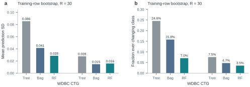

图 7｜相同训练扰动下的重复预测。a，平均预测概率 SD；b，曾发生类别翻转的验证样本比例。WDBC 与 CTG 分别在各自固定验证集评价；主图按行重抽样，CTG 的整录音版本另见第 12 节。30 次重训不增加独立验证记录数。

表 6｜共享训练行 bootstrap 的稳定性统计

| 数据 | 模型 | 平均预测 SD | 类别翻转率 |
| --- | --- | --- | --- |
| WDBC | 单树 | 0.085512 | 24.5614% |
| WDBC | Bagging | 0.041463 | 15.7895% |
| WDBC | RF | 0.028439 | 7.0175% |
| CTG | 单树 | 0.027644 | 7.5472% |
| CTG | Bagging | 0.014693 | 4.7170% |
| CTG | RF | 0.015784 | 3.5377% |

### 7.3　平均的作用在预测层面检验

WDBC 的单树平均 SD 为 0.0855，bagging 为 0.0415，森林为 0.0284；翻转率依次为 24.6%、15.8%、7.0%。结果与平均降低训练扰动方差的解释一致。

稳定性本身不评价预测正确性：一个持续错误的模型也可具有低波动，因此必须并列报告验证指标。

### 7.4　不同稳定性指标为何不一致

CTG 的 bagging 平均 SD 略低于森林，但翻转率略高。前者衡量概率变化幅度，后者取决于是否跨过 0.5，二者不要求相同排序。

例如概率从 0.10 到 0.40 变化较大但不翻类，0.49 到 0.51 变化很小却跨阈值。本次未对 LR、SVM、GB 作同样重训，不能外推它们的稳定性排名。

## 8　AdaBoost 的权重更新与顺序依赖〔实践 E〕

### 8.1　当前误分如何影响下一轮

AdaBoost 起初赋予训练记录相同权重，拟合一个简单分类器后提高错分记录的相对权重，下一轮据此学习，最终加权组合各轮分类器。[6]

式（8）给出本次离散二分类的更新写法：εₜ 是当前加权错误率，αₜ 是模型贡献权重；I 为错分指示，Zₜ 将全部样本权重归一化为和 1。

### 8.2　关注难例并非独立重抽样

当 0<εₜ<0.5 时，错分记录乘以大于 1 的因子，下一轮的目标分布因此依赖当前模型。与 bagging 相比，不能把这些阶段任意独立训练后再组合。

某些推导用 ±1 编码和带 1／2 的 α，归一化后可得到等价权重关系。这里使用数据的 0／1 编码，与本次实现的离散更新对应。

> αₜ=ln[(1−εₜ)/εₜ]；wᵢᵗ⁺¹=wᵢᵗ exp(αₜI[hₜ(xᵢ)≠yᵢ])/Zₜ　（8）
注：t 为提升轮次；εₜ 为加权错误率，αₜ 为分类器权重，wᵢᵗ 为记录权重；I[·] 在错分时取 1，否则取 0，Zₜ 用于归一化。

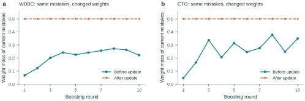

图 8｜同一批本轮错分记录在更新前后的权重占比。a，WDBC；b，CTG。依据已拟合模型的前 10 个基分类器及其 α，重建样本权重。橙色曲线接近 0.5 是本次二分类、学习率 1 的更新结果，不表示下一轮分类器错误率必为 50%。

表 7｜前三轮权重追踪

| 数据 | 轮次 | 错分记录数 | 更新前权重占比 | 更新后权重占比 |
| --- | --- | --- | --- | --- |
| WDBC | 1 | 23 | 0.0674 | 0.5000 |
| WDBC | 2 | 27 | 0.1231 | 0.5000 |
| WDBC | 3 | 109 | 0.2007 | 0.5000 |
| CTG | 1 | 59 | 0.0461 | 0.5000 |
| CTG | 2 | 267 | 0.1659 | 0.5000 |
| CTG | 3 | 564 | 0.3371 | 0.5000 |

### 8.3　从权重变化到预测组合

第一轮 WDBC 错分 23 条，其合计权重由约 6.7% 升至 50%；CTG 错分 59 条，由约 4.6% 升至 50%。记录数未变，改变的是它们在下一轮拟合中的相对影响。

最终预测还需整合各轮模型，不能把某一轮权重变化直接解释为个体概率变化。

### 8.4　噪声敏感性的来源

如果持续难分的记录实际上由测量误差、缺失信息或错标造成，继续强调它们可能追随噪声。训练改善并不必然转化为验证收益。

树桩能力有限，但有一定可利用信号即可逐轮组合；随机森林中的充分生长深树则未必是弱分类器。两种方法不应只按“很多弱模型”混同。

## 9　负梯度拟合、学习率与提升轮数〔实践 E〕

### 9.1　从概率损失得到修正方向

梯度提升逐轮增加修正函数，以降低当前损失。二分类在原始分数尺度上更新，再经 sigmoid 转为概率。[5]

y=1、p=0.2 时 r=+0.8；y=0、p=0.8 时 r=−0.8。已分对的记录也可能需要修正，因此 GB 并非只拟合错分样本。

### 9.2　更新发生在原始分数尺度

基树拟合可正可负的连续修正量，因此使用回归树；整体仍完成分类。式（9）概括顺序加法机制。

式（10）给出拟合方向；实际实现还可对叶值作损失相关更新。更新发生在原始分数上，不能向概率直接任意累加。

> p=1/(1+exp(−F))；Fₜ(x)=Fₜ₋₁(x)+ηhₜ(x)　（9）
> ℓ=−y ln(p)−(1−y)ln(1−p)；r=−∂ℓ/∂F=y−p　（10）
注：F 为原始分数，p 为正类概率，y∈{0,1} 为标签；hₜ 为第 t 轮修正树，η 为学习率。ℓ 为单样本损失，r 为负梯度；∂ℓ／∂F 表示损失对分数的变化率。

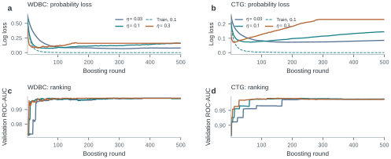

图 9｜三种学习率下的实际阶段结果。a、b，验证 log-loss，虚线另示 η=0.1 的训练损失；c、d，同阶段验证 AUC。每条路径拟合至 500 轮，固定输入和验证记录。最小验证点属于开发阶段选择，不能作为无偏独立评价。

表 8｜η=0.1 的阶段核对

| 数据 | 轮数 | 训练 log-loss | 验证 log-loss | 验证 AUC |
| --- | --- | --- | --- | --- |
| WDBC | 50 | 0.012612 | 0.079027 | 0.997052 |
| WDBC | 100 | 0.001305 | 0.088547 | 0.996725 |
| WDBC | 500 | 0.000000 | 0.161707 | 0.997380 |
| CTG | 50 | 0.009985 | 0.074625 | 0.964480 |
| CTG | 100 | 0.002880 | 0.078973 | 0.987745 |
| CTG | 500 | 0.000002 | 0.145837 | 0.988499 |

### 9.3　排序不变仍可增加损失

WDBC 从 50 到 500 轮，验证损失由 0.079 升至 0.162，AUC 都约 0.997。排序可保持近似，而少数错误概率变得更自信；log-loss 对此继续惩罚。

逐轮最小损失在 WDBC、CTG 分别为 83、66 轮，仅对当前验证划分成立。轮数应用验证或早停控制，CTG 的早停划分也须按录音隔离。

### 9.4　实现与复杂度控制

η 越小通常需要更多轮，但 η 与轮数乘积相同不保证学习路径相同。深度、叶节点、subsample 与正则化也影响结果。

XGBoost 与 LightGBM 同属梯度提升树：引入高效树构建、二阶信息及复杂度控制。经典 sklearn GB 与直方图 GB 的缺失值支持等能力不同，不能混为同一实现。

## 10　切分贡献、置换重要性与相关结构〔实践 D〕

### 10.1　训练贡献与预测依赖

不纯度重要性累加某特征在树切分中带来的加权不纯度下降，再归一化、跨树汇总。其计算快，但可能偏向可选阈值多的变量，相关特征也会竞争切分或分摊贡献。

置换重要性固定已拟合模型，打乱验证集某一变量的记录对应关系，再观察表现损失。它评价该模型在该验证分布下对该变量的依赖。[7]

### 10.2　固定模型与评分口径

独立拟合 300 棵森林，提取不纯度重要性，并在固定验证集上逐变量置换 20 次，统一用 ROC-AUC 评分。它与主比较的 100 棵森林是不同拟合对象。

式（11）中 j 为被打乱特征；Iⱼ 取正表示 AUC 下降。重复置换 SD 描述打乱过程的波动，不是重新训练或人群抽样区间。

> Iⱼ=AUC_base−AUC_perm(j)　（11）
注：j 为特征编号；AUC_base 为原验证 AUC，AUC_perm(j) 为打乱第 j 个特征后的 AUC，Iⱼ 为两者之差。

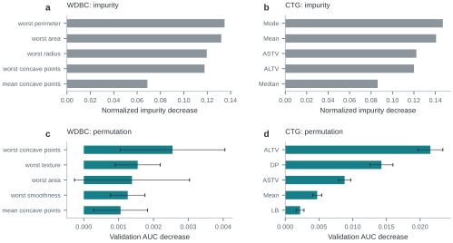

图 10｜两种重要性定义下的前五个变量。a、b，不纯度重要性；c、d，验证 AUC 置换降幅。误差线为 20 次置换的 SD。各面板按自身定义排序，不将两类数值相加或比较倍数。重要性是模型依赖的预测解释，不是生物学因果效应。

表 9｜WDBC 相关大小特征的两种读数

| 特征 | 不纯度重要性 | 置换 AUC 降幅 | 置换 SD |
| --- | --- | --- | --- |
| worst perimeter | 0.134799 | 0.000197 | 0.001342 |
| worst area | 0.131994 | 0.001384 | 0.001650 |
| worst radius | 0.119587 | 0.000074 | 0.000875 |

### 10.3　高度相关时的替补解释

周长、面积、半径的训练相关系数绝对值均超过 0.9。不纯度贡献较高，但单独置换后 AUC 降幅很小，符合其他大小变量仍可提供相近信息的解释。

这不等于大小信息无用。相关矩阵提供冗余线索，尚不足以独自识别全部替补关系；必要时可进一步考虑按组置换。

### 10.4　排名不同不构成矛盾

CTG 的不纯度前列包含 Mode、Mean、ASTV、ALTV；置换降幅前列是 ALTV、DP、ASTV，约为 0.0215、0.0143、0.0088。

近零或负置换值可能来自冗余、未使用或有限样本波动。打乱还可能形成罕见变量组合，因此不能把单一排名直接转为删特征决策或因果结论。

## 11　统一协议下的模型比较与阈值解释〔实践 F〕

### 11.1　共享五折与折内预处理

开发集使用共享五折：WDBC 分层，CTG 按录音分组。LR 与 RBF-SVM 在训练折内标准化，树模型保留原尺度，参数沿用预定配置。

AUC 使用连续得分，描述正负类排序；SVM 决策分数并非概率。AP 使用 `average_precision`，不与梯形积分的 PR 面积混称。

### 11.2　分类结果需要阈值口径

敏感度衡量正类检出，特异度衡量负类排除，BA 取二者平均。它们评价特定阈值下的分类结果，与排序指标 AUC 回答不同问题。

CTG 全部猜负类可有约 91.7% 总体准确率，但 BA=0.5。指标应与目标一起解释，不能仅按 accuracy 排名。

> TPR=TP/(TP+FN)；TNR=TN/(TN+FP)；BA=(TPR+TNR)/2　（12）
注：TP、TN 分别为正确检出的正、负类数，FP 为误报数，FN 为漏报数；TPR 为敏感度，TNR 为特异度，BA 为平衡准确率。

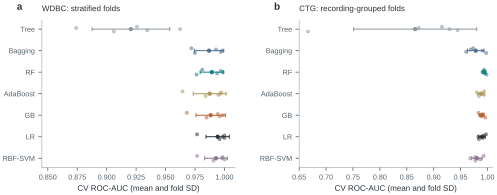

图 11｜相同开发折上的七模型比较。小点为各折 AUC，大点及横线为均值±折间样本 SD。a，WDBC；b，CTG。SD 不是 95% 置信区间；由于使用相同折，方法差异具有配对关系，不能仅凭横线重叠与否作显著性判断。

表 10｜开发集交叉验证的主比较

| 模型 | WDBC AUC±SD | CTG AUC±SD | CTG AP | CTG BA |
| --- | --- | --- | --- | --- |
| 单树 | 0.9205±0.0329 | 0.8656±0.1144 | 0.7369 | 0.8971 |
| Bagging | 0.9869±0.0125 | 0.9782±0.0154 | 0.8917 | 0.9163 |
| RF | 0.9893±0.0100 | 0.9941±0.0029 | 0.9442 | 0.9247 |
| AdaBoost | 0.9874±0.0139 | 0.9879±0.0058 | 0.9009 | 0.8837 |
| GB | 0.9883±0.0125 | 0.9893±0.0047 | 0.9382 | 0.9277 |
| LR | 0.9942±0.0099 | 0.9898±0.0061 | 0.9231 | 0.8716 |
| RBF-SVM | 0.9928±0.0096 | 0.9804±0.0096 | 0.8752 | 0.7972 |

表 11｜CTG 固定验证集的两类错误

| 模型 | TP | FN | FP | TN | 敏感度 | BA |
| --- | --- | --- | --- | --- | --- | --- |
| RF | 27 | 7 | 1 | 389 | 0.7941 | 0.8958 |
| LR | 29 | 5 | 4 | 386 | 0.8529 | 0.9213 |

### 11.3　集成收益需相对基线判断

WDBC 的森林改善单树，但 LR／SVM 已很好。RF 与 LR 的 CV AUC 差约 0.0049，小于各自约 0.010 的折间 SD，不支持凭小数位宣布复杂模型占优。

### 11.4　排序与检出并非同一目标

CTG 验证 RF AUC=0.996，略高于 LR 的 0.994；LR 却多检出 2 个正类，同时多 3 个误报。排序优势不能替代默认阈值分类表现；阈值若需优化，也只能在开发阶段进行。

## 12　抽样层级、指标区间与外部范围〔实践 G〕

### 12.1　相关片段改变评价问题

CTG 若改为按行分层 CV，每折有 154—167 个录音同时出现在训练与验证。相似片段的重叠使其评价对象偏向“已见录音中的新片段”，不能等同于面对未见录音。

按行时单树 AUC 均值约 0.932，分组后为 0.866；森林分别约 0.997、0.994。两种划分的训练构成也不同，差值不应全部归给某一个因素。

### 12.2　训练重抽样也需明确单位

补充实验从 209 个训练录音中有放回抽 209 个，每次保留所选录音全部片段，再在原固定验证录音上评价；共 30 次。每次训练片段数可以变化。

整录音抽样下，森林平均 SD 从行抽样的 0.0158 变为 0.0206。抽样单位改变了扰动机制，不能把行级结果直接当作录音层面的完整不确定性。

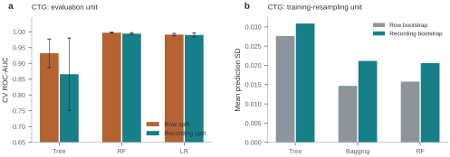

图 12｜CTG 分组结构的两项核查。a，相同开发数据的按行与按录音 CV，误差线为折间 SD；b，固定验证记录下，训练行与训练录音 bootstrap 的平均预测 SD。b 重新训练模型，不能解释成固定模型 AUC 的置信区间。

表 12｜CTG 训练重抽样层级与预测变化

| 模型 | 行抽样 SD | 录音抽样 SD | 行抽样翻转率 | 录音抽样翻转率 |
| --- | --- | --- | --- | --- |
| 单树 | 0.027644 | 0.030892 | 7.55% | 9.67% |
| Bagging | 0.014693 | 0.021163 | 4.72% | 6.13% |
| RF | 0.015784 | 0.020580 | 3.54% | 3.30% |

### 12.3　固定模型的指标重抽样

固定 RF／LR 的验证预测，不重训模型，配对抽取评价索引 1,000 次；WDBC 抽行，CTG 抽整录音。AUC 差 RF−LR 的探索性百分位 95% 区间分别约为 [−0.0094,0] 与 [−0.0030,0.0099]。

该区间条件于当前模型与验证数据，不包括重训和选模变化，也未作完整选择后推断；CTG 区间跨 0，提示小的验证 AUC 差应谨慎解释。

### 12.4　三种不确定性分别陈述

训练 bootstrap 回答更换训练样本后预测如何变化；固定预测的评价 bootstrap 回答评价样本变化后指标如何变化；新医院或新人群则涉及来源、设备和病例构成变化。

当前数据没有外部队列。CTG 按录音隔离也不等于按孕妇完全隔离；WDBC 缺患者分组信息。因此本报告不证明跨医院适用性，也不建立因果效应。

## 13　Bagging、Boosting 与有条件的模型选择〔实践 H〕

两类集成都组合基学习器，但改进路径不同。Bagging 用独立拟合后的聚合降低可抵消的波动，boosting 则利用前一阶段的信息逐步增强拟合。二者均涉及偏差与方差，不能把“主要降低”理解为“只影响其中一项”。

表 13｜训练机制与使用条件

| 方面 | Bagging／随机森林 | Boosting |
| --- | --- | --- |
| 训练关系 | 基模型可独立训练、并行 | 阶段顺序依赖 |
| 每轮数据或目标 | Bootstrap 训练表；森林另抽节点候选特征 | AdaBoost 改权重；GB 拟合负梯度 |
| 典型基学习器 | 较深、拟合能力较强的树 | 树桩或浅树，依任务调整 |
| 聚合方式 | 概率／预测平均或类别投票 | 模型加权组合或阶段修正累加 |
| 主要改进方向 | 降低训练扰动方差 | 增强拟合能力、主要降低偏差 |
| 噪声与轮数 | 常趋平台，但仍受复杂度和数据问题影响 | 可能追随难例或噪声，需控制轮数 |
| 关键参数 | 树数、max_features、叶节点大小、深度 | 学习率、轮数、深度、采样与正则化 |

### 13.1　WDBC 的选择依据

本研究在 WDBC 开发数据上比较七类分类方法，沿用固定训练与验证划分，并采用分层五折交叉验证。单树 CV AUC 为 0.921，随机森林为 0.989，说明集成改善单树；逻辑回归为 0.994，复杂模型未显示超过简单基线的优势。共享训练重抽样中，森林类别翻转率为 7.0%，低于单树的 24.6%，支持其在本扰动条件下更稳定。结合系数解释需求与模型简洁性，可优先保留逻辑回归，以 SVM 和森林作对照；但本次未验证逻辑回归的重训稳定性。结论限于当前特征、标签和协议，不代表未来风险或跨医院效用。若独立数据中集成出现可重复且有实际意义的性能或校准改善，应重新评估选择。

### 13.2　CTG 的选择依据

本研究对 CTG 病理型标签分类，训练、验证与交叉验证均按录音隔离。森林分组 CV AUC 为 0.994、AP 为 0.944，高于逻辑回归的 0.990、0.923；梯度提升的 CV 平衡准确率也值得保留。固定验证集中，逻辑回归在默认阈值下检出更多正类，说明排序优势不能代替阈值表现。共享重抽样支持树集成较单树稳定，整录音抽样下森林平均 SD 为 0.0206。考虑森林及提升模型的解释成本，可保留二者并以逻辑回归对照，在开发阶段按预定目标选择阈值与轮数。结论只限本数据和录音分组条件，不保证新医院效用；若外部录音中敏感度、校准或相对基线收益明显下降，应改变当前建议。

### 13.3　模型选择需要的补充信息

新任务至少应明确观察单位、标签含义、正类比例、分组与时间结构、是否需要概率，以及解释和计算要求。近似线性且解释需求高时，可先考虑 LR；中小样本的弯曲边界可用 RBF-SVM；非线性或交互较多的表格数据可比较森林与梯度提升。

这些是设定候选的经验，不是预定排名。当前稳定性实验证据只覆盖三类树方法；GB、LR、SVM 的重训稳定性仍需追加同协议比较。解释成本也不能仅由是否能画重要性图决定。

## 14　讨论、方法控制与可复现性

### 14.1　机制链及其适用条件

单树的叶节点概率来自训练区域内的类别分布，深度增加使规则细化，却不保证验证改善。训练重抽样显示树结构与预测可以变化，为聚合降低方差提供了可检验的问题。

平均收益受模型间依赖限制；随机森林尝试以节点特征随机化增加差异，boosting 则通过权重或负梯度顺序修正。WDBC 与 CTG 给出的不同收益说明，机制解释需要与具体数据结构和评价目标共同成立。

### 14.2　标准化与数据隔离

树主要依赖大小顺序，正比例单位变换通常不改变可实现切分；LR 的正则化与 RBF-SVM 的距离结构则受尺度影响。本次二者使用折内 pipeline。

式（13）的均值、标准差只由当前训练部分估计。验证与测试仅应用同一变换；即使用不到标签，全数据拟合 scaler 也提前利用了保留分布。

### 14.3　结论范围

CV 折间波动不能单独证明方法优效，开发验证最低损失包含选择影响。当前结论均为内部开发证据，测试标签未打开，未进行外部验证。

重要性、训练稳定性与固定模型指标区间分别对应不同对象。本实验不以特征排名推出因果，也不以高 AUC 批准临床应用。

### 14.4　数据、配置与计算来源

输入限于两套学生 train、validation。原课件、工作单和教学脚本均保留；独立驱动程序调用其数据读取与模型定义，避免原 main 的目录层级假设。

种子为 1010。主比较为深度 4 单树、100 棵全特征 bagging、100 棵 sqrt 森林、50 轮 AdaBoost、100 轮 GB；LR、SVM 配置与原课堂脚本一致。森林重要性另拟合 300 棵，重复置换 20 次。

开发集共用五折；CTG 每折核验录音不重叠。主稳定性共用 30 份行 bootstrap，补充 CTG 30 次整录音 bootstrap。GB 各学习率取完整 500 个阶段，不用测试选择轮数。

环境为 Python 3.12.6、scikit-learn 1.9.1、NumPy 2.5.4、pandas 2.3.3。输入哈希、逐折结果、逐阶段损失与重复预测均保留。此次修订沿用已核验实验，仅重组论述、数表与绘图，没有新增模型筛选。

### 结论

集成改善不来自模型数量本身，而来自可抵消的训练波动或有目标的顺序修正。公平评价应把排序、阈值分类、概率质量、训练稳定性与解释成本分开测量，再据同一协议形成有条件的选择。

> zⱼ=(xⱼ−μⱼ)/sⱼ；μⱼ、sⱼ仅由训练部分估计　（13）
注：xⱼ 为第 j 个特征的原值，μⱼ、sⱼ 为当前训练部分的均值与标准差，zⱼ 为标准化后的值。

### 参考资料

[1] UCI. Breast Cancer Wisconsin (Diagnostic). DOI: 10.24432/C5DW2B；本课 `data/README.md`。

[2] Campos D, Bernardes J. Cardiotocography. UCI, 2000. DOI: 10.24432/C51S4N；本课 `data-ctg/README.md`。

[3] 本课课件 `ensemble-pbl.pptx`（19 页）、`student-worksheet.md`（A—H）与 `scripts/demo_ensemble.py`。

[4] Breiman L. Bagging predictors. Machine Learning. 1996;24:123–140. DOI: 10.1007/BF00058655.

[5] Friedman JH. Greedy function approximation: A gradient boosting machine. Ann Statist. 2001;29:1189–1232. DOI: 10.1214/aos/1013203451.

[6] Freund Y, Schapire RE. A decision-theoretic generalization of on-line learning and an application to boosting. J Comput Syst Sci. 1997;55:119–139. DOI: 10.1006/jcss.1997.1504.

[7] scikit-learn. Ensemble methods; Permutation feature importance. scikit-learn.org/stable/modules/ensemble.html。

[8] Breiman L. Random forests. Machine Learning. 2001;45:5–32. DOI: 10.1023/A:1010933404324.
